# Issue #24: 分割後の規模評価

分割して活動中のExperimentが増えたとき、共有装置の計画と履歴管理に
どの程度の時間・メモリが必要かを調べた。まず図で測定条件を説明し、後半に結果と検証を示す。
工程は仮想操作で、細胞の取り分けを実機で行った測定ではない。
全件終了後に親子関係と作業の時間を振り返る表示は、
[別の設計資料で4案を比較する](../../design/experiment_retrospective/README.md)。

## 分割後に、何を計画するのか

1つのExperimentを図では「親」「子」と呼ぶ。
分割すると、親は活動中の一覧から外れ、子がそれぞれ独立した実験になる。
親の履歴を継承しながら、子ごとに自分の観測と作業の進行を管理する。

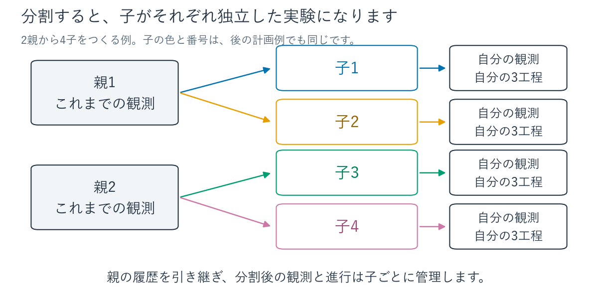

基本測定では親P個を各2子へ分割し、活動中の子2P個を一括計画する。
以下の装置の図は、まず2親・4子の小さな例で読む。
子の番号と色は計画例でも揃え、色だけで識別しなくても追えるようにした。

## 1つの子が行う作業

各子は、同じ3工程を持つ。最初の工程前にも2分待ち、
工程の間には2分・1分の間隔を置く。この1セットをTask群と呼ぶ。

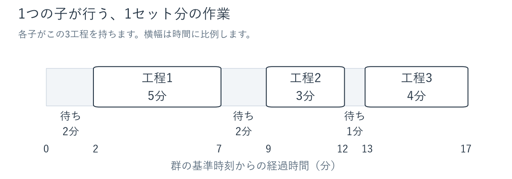

図の横軸は実験の論理時間で、単位は**分**。
後半の「1秒／60秒」は計画を計算する時間である。
固定予約を含む再計画の条件だけ、工程2前の待ちを長くする。

## 5つの条件で、何を変えるのか

| 条件 | 変えるもの | 確認したいこと |
| --- | --- | --- |
| 同型装置の競合 | 全工程で同じ2台を共有 | 子が増えても、重複せずに装置を割り当てられるか |
| 異種工程 | 工程ごとに2台・2台・1台 | 装置の種類と台数が異なる手順を計画できるか |
| 割当候補多数 | 同型装置を8台に増やす | 各工程で選べる装置が多い場合の計算負荷はどうか |
| 複雑ペナルティ | 子ごとに希望時刻の評価を変える | 異なる開始時刻の希望をまとめて計画できるか |
| 固定予約を含む再計画 | 一部の子の予約を固定する | 決定済みの予約を保ったまま、ほかの子を計画できるか |

折りたたみの「保存された計画例」には、実際の保存出力から描いた装置別の時間図を置いた。
棒の**色が子、番号が工程**を表す。設定図を読んだ後、必要な例を開いて確認できる。
これは計画の出力例であり、実機の実行記録や毎回同じ割当になる保証ではない。

### 同型装置の競合：contention

どの子も、全工程で同じ装置A・Bを使う。
子ごとに専用の装置を持つ構成ではなく、各工程で空いている1台を割り当てる。
同じ装置の予約は重ねられない。

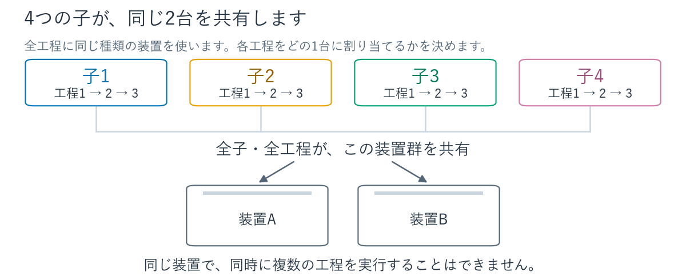

<details>
<summary>保存された計画例を見る：4子が2台を共有</summary>

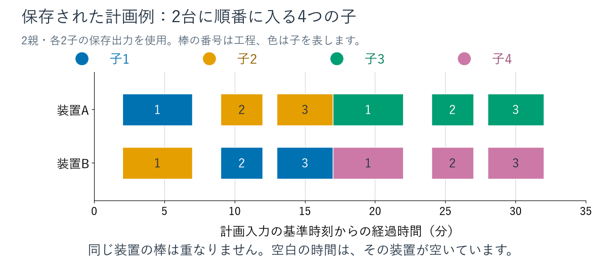

この出力では子1・2が先に入り、子3・4は後から始まる。
1つの子でも、工程によって装置A・Bを使い分けている。

</details>

### 異種工程：heterogeneous

子が行う3工程は同じだが、工程ごとに必要な装置の種類が変わる。
工程1用が2台、工程2用が2台、工程3用が1台。各種類の装置を全子で共有する。

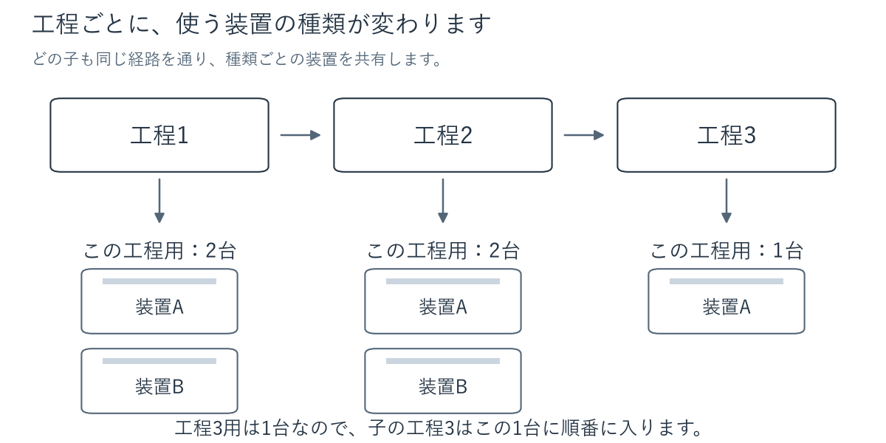

<details>
<summary>保存された計画例を見る：工程3用の1台に順番に入る</summary>

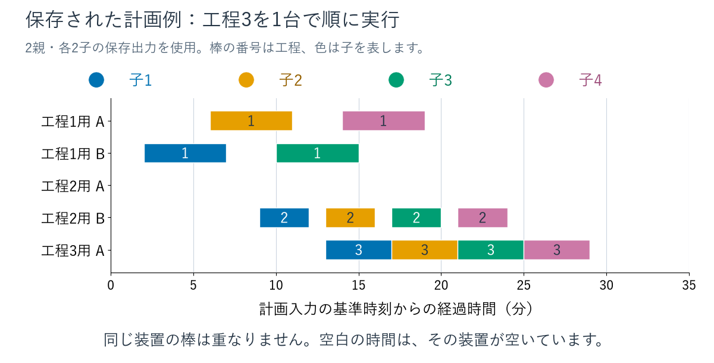

工程3の棒が1列に並ぶ。同じ時刻に別種類の装置を使うことはできる。
空白はその装置の空き時間で、この出力では工程2用Aを使っていない。

</details>

### 割当候補多数：many_candidates

同型装置の競合と同じ作業で、共有装置を2台から8台に増やす。
各工程で選べる装置が増えるため、並行作業の余地と計画の選択肢がともに増える。

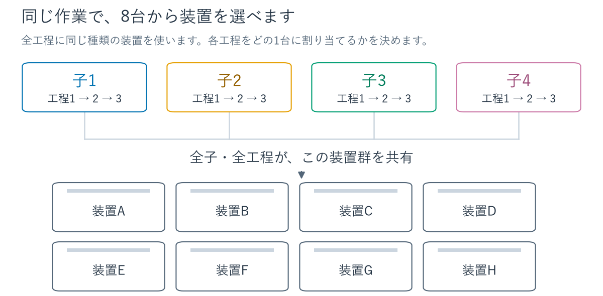

### 複雑ペナルティ：mixed_penalties

作業と共有装置2台はそのままに、子ごとに開始時刻の希望を変える。
希望からのずれを「費用」という数値で評価し、費用の小さい開始時刻を優先する。
子1はずれに比例、子2は±2分まで費用ゼロ、子3は周期的な休止帯を避けたい条件。
以降の子にも、この3種類を順番に繰り返す。

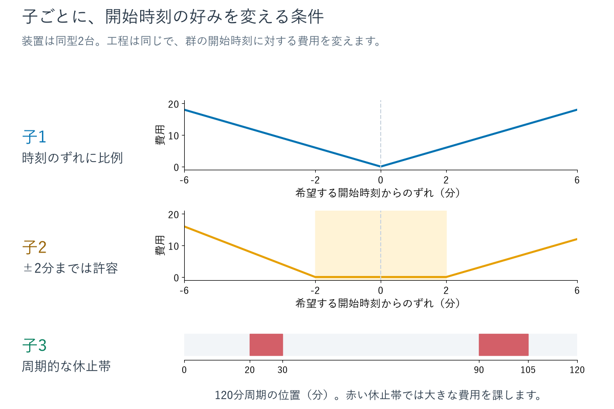

休止帯は大きな費用を課す条件で、実行を禁止する制約ではない。
線形費用の係数は3。許容幅の外側は早い側4・遅い側3。
周期的休止帯の外側にも線形費用を使う。
ほかの4条件は、全子に線形費用を使う。

### 固定予約を含む再計画：replanning

子1の工程1は完了し、工程2・3は装置Aに予約済み、という途中状態から計画する。
残りの子は未開始。固定予約の時刻と装置を保ったまま、その空きと装置Bを使って計画する。

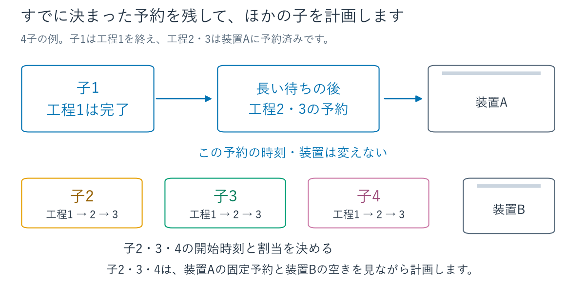

<details>
<summary>保存された計画例を見る：斜線の予約は動かさない</summary>

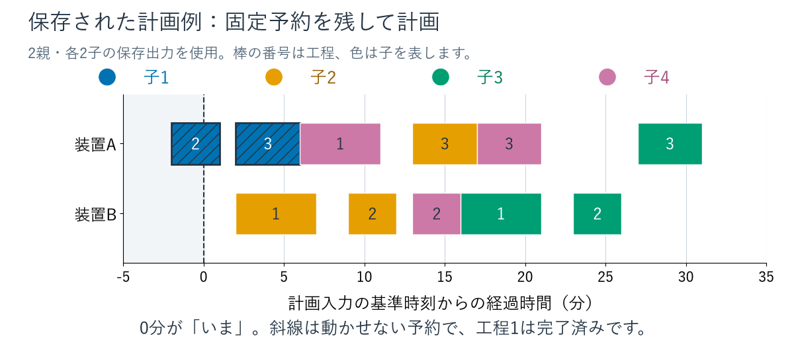

0分が計画入力の現在時刻。子1の工程2はすでに進行中で、工程3は将来の固定予約である。
ほかの子の棒は、この予約と重ならない場所に入る。完了済みの工程1は表示を省いた。

</details>

規模を増やすと、図の1始まりの子番号で子1・5・9…を固定群にする
（入力の0始まりの番号では0・4・8…）。
固定群の工程2前の待ちは`2 + 20N`分で、4子の例では82分。
Nは活動中の子数。完了した工程の観測も履歴に加えた合成入力を使う。

## 子数・世代数・履歴量は、それぞれ別に変える

基本走査は親1/2/4/8/16/32/64/128個、各親2子・1世代。
次の追加比較は親8個を基準に、**一度に変える条件を分けて**測定する。

### 各親から生まれる子を増やす

各親2子なら活動中16個、4子なら32個、8子なら64個。
3つは独立した測定条件で、1回の測定で順に増やす操作ではない。

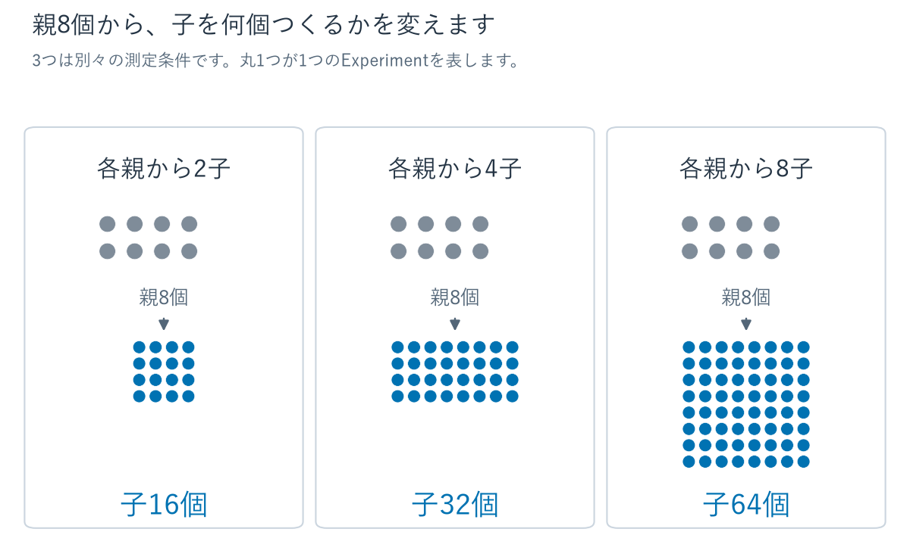

### 子をもう一度分割して、2世代にする

親8個から各2子、さらに各子から2孫をつくる。最後に計画する活動中Experimentは32個。
親・中間の子は終了記録に移り、孫がその履歴を引き継ぐ。
中間の子には、再分割の前に追加の合成観測を与える。

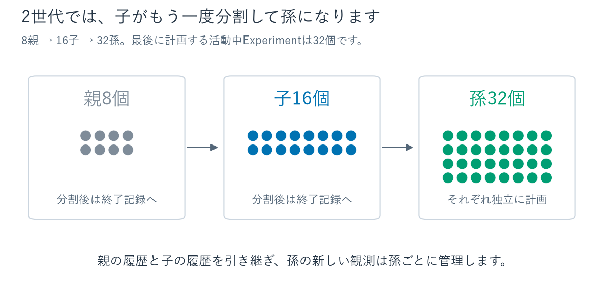

### 分割前の履歴量を増やす

8親・各2子・1世代を固定し、親の合成観測を3/6/12行に変える。
各子には初期観測1行を与える。入力生成器の「完了群間隔I」1/2/4が、この履歴量に対応する。

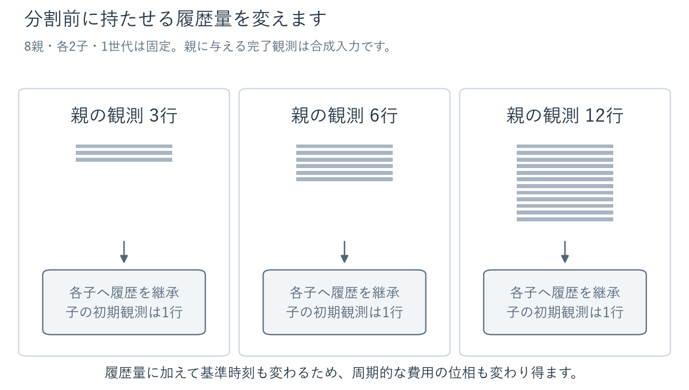

基準時刻も変わるため、周期的費用の位相が変わる場合がある。
結果を純粋な履歴量だけの影響として読むことはできない。

## 分割ありとflatは、同じ作業を比較する

flatは、同じ活動中の子・工程・装置・履歴値を使い、
継承した履歴を各子の履歴に結合して、親子記録を外した比較入力。
子の数や物理的な作業量を減らして比較するものではない。

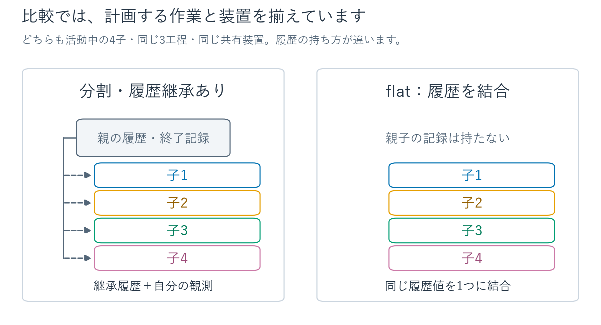

上記の条件を5負荷それぞれで、計画全体1秒／60秒、分割あり／flatの組として測る。

## 測定結果と保存資料

344試行・172比較組を完了し、全入力と同一世代のJSON/pickle保存を照合した。
予定した基本走査・条件比較260試行に欠落・重複はない。
時間内完了88件、有効な時間超過250件、UNKNOWN 6件で、スキップはない。
この集計は分割ありとflatの両方を含む。

資料は保存コミット
[`8ca9080bf62a4e6c2b70fe73a0f830c5f627b183`](https://github.com/bioinfo-tsukuba/GEMS-python/tree/8ca9080bf62a4e6c2b70fe73a0f830c5f627b183/docs/benchmarks/experiment_lifecycle_capacity_2026-10-30)
に固定する。
[詳細な表・図・CSV/JSON](https://github.com/bioinfo-tsukuba/GEMS-python/blob/8ca9080bf62a4e6c2b70fe73a0f830c5f627b183/docs/benchmarks/experiment_lifecycle_capacity_2026-10-30/statistics/README.md)、
[入力・出力・保存の照合結果](https://github.com/bioinfo-tsukuba/GEMS-python/blob/8ca9080bf62a4e6c2b70fe73a0f830c5f627b183/docs/benchmarks/experiment_lifecycle_capacity_2026-10-30/verification.json)、
[圧縮資料の内容・再生成方法](https://github.com/bioinfo-tsukuba/GEMS-python/blob/8ca9080bf62a4e6c2b70fe73a0f830c5f627b183/docs/benchmarks/experiment_lifecycle_capacity_2026-10-30/README.md)
を参照する。保存ブランチは固定資料の参照用に保持する。

## 3反復で確認した規模

基本条件は1親→2子、1世代。表は分割ありの3反復がすべて時間内だった最大の確認点。
括弧内は活動中の子Experiment数。
未測定の中間規模や、実施設の処理能力の上限を示す値ではない。

| 負荷 | 計画全体1秒以内：親数（子数） | 計画全体60秒以内：親数（子数） |
| --- | ---: | ---: |
| 同型装置の競合 `contention` | 2（4） | 2（4） |
| 異種工程 `heterogeneous` | 2（4） | 4（8） |
| 割当候補多数 `many_candidates` | 4（8） | 4（8） |
| 複雑ペナルティ `mixed_penalties` | 2（4） | 2（4） |
| 固定予約を含む再計画 `replanning` | 2（4） | 2（4） |

異種工程の60秒条件では、8親は走査で59.998秒だったが、反復を含めると時間内は1/3。
4親を追加確認し、3/3を確認点とした。ほかの次の反復確認点は時間内0/3だった。
上位の不安定な点と時間超過の資料も保持している。

CP-SATの探索上限と計画全体の時間条件をともに1秒／60秒に設定した。
探索が上限近くまで最適化を続けると、有効な計画が得られても
構築・検査・反映を含む全体時間は上限を超える。この評価は、解の有効性と時間内完了を分ける。
UNKNOWNの6件は1秒条件の候補多数128親、複雑ペナルティ64／128親で、
各条件の分割あり・flatの両方に発生した。実行不能の証明として扱わない。

基本走査の8親では、分割を含む前処理は約0.033〜0.035秒。
初期化は別プロセスで344件を補足計測し、すべて元入力ハッシュと一致した。
前処理、計画、保存、元試行の全工程、補足初期化は別々の指標である。
flatも同じ分割fixtureから作るため、前処理とピークRSSは
「分割を一度も行わない実装」との純粋な追加費用にはならない。

## 設定と検証

計測対象は `a719506311b75dcbc55598dd1055f31b9c2a9a00`。
再開時に実装全ファイル、基礎計測器、入力生成・workerのAST、
Python・依存freezeの一致を検査した。以降の変更は実行管理、独立検査、集計、試験、文書に限る。

- 親1/2/4/8/16/32/64/128、基本2子。8親で子4/8、完了群間隔1/4、2世代も比較。
- 決定的入力、seed 0、solver 1 worker、Pandas。比較測定ではUNKNOWNの再試行を無効化。
- 管理層の計画入口から、入力検査・モデル構築・探索・予約検査・反映完了までを計画全体とする。
- 同条件の分割あり／flatで物理条件のハッシュを照合。固定予約、登録装置、
  Task仕様、初期条件・由来、履歴、系譜、時計・方針、保存内容の不変も検査。
- Intel Core Ultra 7 265KF、WSL2、Python 3.14.4、OR-Tools 9.15.6755、
  Pandas 3.1.0、Polars 1.44.2、PyArrow 26.0.0。完全な環境は保存資料に記録。
- 主測定・追加反復は2026-10-30 10:13:46 UTC、補足初期化は10:17:52 UTCに終了。
  初回予備開始07:25:22 UTCから最大21600秒の期限を維持した。

4209ファイルを圧縮内から読み出して全SHA-256を照合し、公開資料のハッシュも一致した。
再探索なしの再生成でREADME、2 CSV、集計JSON、PNG、SVGの6ファイルがバイト一致した。
PNGの軸・凡例・判定表示も目視確認した。
機能受入と全147テストの比較は[実装・検証記録](../issue24_verification.md)に記載する。

<details>
<summary>設定図の根拠・検証・再生成方法</summary>

本文の設定図は説明用の概念図。3枚の装置別時間図は、
保存資料の基本走査「2親・各2子・1世代・群間隔2・計画1秒・分割あり・初回」から描いた。
同型競合は`trial-0002`、異種工程は`trial-0034`、再計画は`trial-0130`。
描画器は5負荷の同条件の入力・出力を読み、入力ハッシュ、子数、装置数、
工程の処理時間・間隔、固定予約、出力予約の有効性を照合する。
計画の再探索は行わない。

図の分割と小さな例の選択は、全体像から条件の違いへ読むための説明上の判断。
日本語のPNGを本文に直接表示し、拡大用のSVGも
[`figures/`](figures/)に同梱する。全14枚を目視し、別出力先へ再生成した
PNG・SVG各14枚とmanifestの29ファイルがバイト一致することを確認した。
文字の描画領域が画像内に収まることも描画器で検査する。
ローカルのMarkdown解釈で画像14枚と折りたたみ4箇所を確認した。
GitHubをブラウザで開いた表示は未確認。
初回描画では短い画像の見出しが上端を超えたため、余白を画素単位で固定した。
目視で見つかった背景による行・矢印の隠れ、子数表示の詰まりも修正して再確認した。

[描画器](../../../scripts/render_experiment_lifecycle_guide.py)は既存のMatplotlibを使う。
フォントは環境にあるYu Gothicを使用し、本体は配布しない。
[manifest](figures/manifest.json)に、生成器・設定・保存入力/出力・フォント・各画像の
SHA-256とMatplotlibの版を記録した。
別の字体や描画環境を使うと、画像のバイト一致は保証しない。

保存資料の`raw.tar.gz`を新しいディレクトリに展開し、
その中の`results.jsonl`と`metadata.json`を含む測定ディレクトリを指定する。
リポジトリのルートから、既存のプロジェクト環境で実行する。
`--output`は上書きを避けるため、存在しない出力先にする。

```bash
MPLBACKEND=Agg MPLCONFIGDIR=/tmp/gems-lifecycle-guide-mpl \
python -m scripts.render_experiment_lifecycle_guide \
  --data /path/to/unpacked \
  --font /path/to/installed/YuGothM.ttc \
  --output /tmp/gems-lifecycle-guide-reproduced
```

</details>

## 解釈上の制限

静的な合成入力の記述統計であり、継続更新下の能力、独立な成功確率、
任意の実験手順・設備での保証は示さない。完了群間隔は合成履歴量の比較であり、
実機の分割頻度の実測ではない。論理時刻と周期的費用の位相も変わり得るため、
条件間の差を純粋な履歴負荷の差として解釈しない。

初期54試行はtmpfs、再開後はワークスペースの保存先を使った。
保存・全工程時間は保存先の異なる反復を混ぜない。
一部の走査中に追加試験・独立検査を行った区間は保存資料の
`auxiliary_verification.json`に記録する。専有環境の測定ではない。

メモリはプロセス全体のピークRSS、履歴行数、入力JSONサイズを記録する。
履歴・系譜だけの常駐メモリは分離していない。
予備commit `eb0cee3`の生資料は一時領域消失で失われ、最終評価には使っていない。
実機分割、不可逆操作の物理的復旧、同時書込みは対象外。
