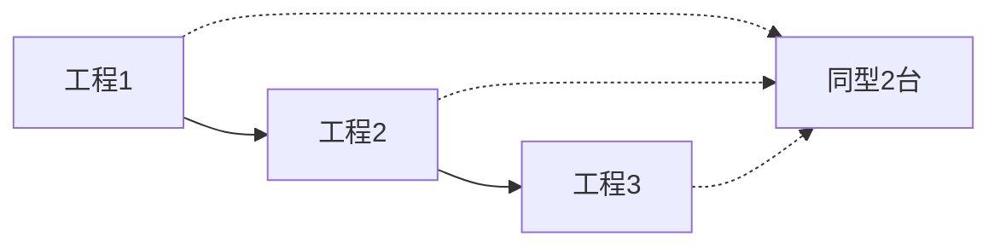
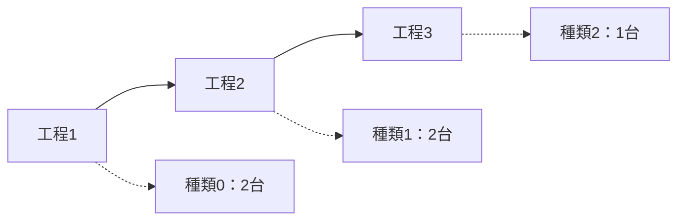
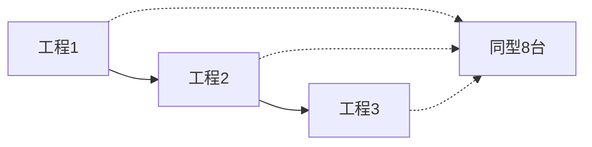
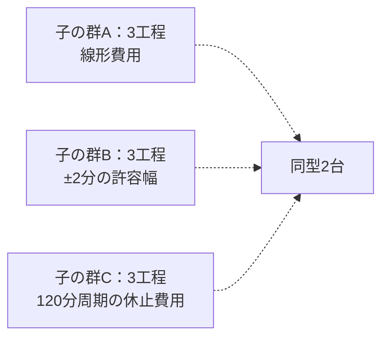
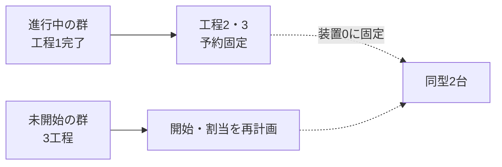
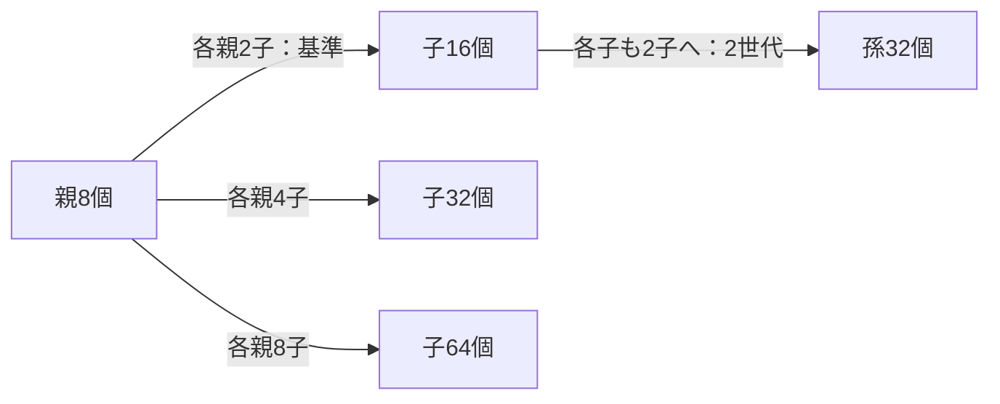

# Issue #24: 分割後の規模評価

344試行・172比較組を完了し、全入力と同一世代のJSON/pickle保存を照合した。
予定した基本走査・条件比較260試行に欠落・重複はない。
時間内完了88件、有効な時間超過250件、UNKNOWN 6件で、スキップはない。
この集計は分割ありとflatの両方を含む。

資料は保存コミット
[`8ca9080bf62a4e6c2b70fe73a0f830c5f627b183`](https://github.com/bioinfo-tsukuba/GEMS-python/tree/8ca9080bf62a4e6c2b70fe73a0f830c5f627b183/docs/benchmarks/experiment_lifecycle_capacity_2026-10-30)
に固定する。
[詳細な表・図・CSV/JSON](https://github.com/bioinfo-tsukuba/GEMS-python/blob/8ca9080bf62a4e6c2b70fe73a0f830c5f627b183/docs/benchmarks/experiment_lifecycle_capacity_2026-10-30/statistics/README.md)、
[入力・出力・保存の照合結果](https://github.com/bioinfo-tsukuba/GEMS-python/blob/8ca9080bf62a4e6c2b70fe73a0f830c5f627b183/docs/benchmarks/experiment_lifecycle_capacity_2026-10-30/verification.json)、
[圧縮資料の内容・再生成方法](https://github.com/bioinfo-tsukuba/GEMS-python/blob/8ca9080bf62a4e6c2b70fe73a0f830c5f627b183/docs/benchmarks/experiment_lifecycle_capacity_2026-10-30/README.md)
を参照する。保存ブランチは固定資料の参照用に保持する。

## 評価した実験の設定

基本条件は親P個を各2子へ分割し、活動中の子2P個を一括計画する。
各子は親の履歴を継承し、独立した観測とTask群を持つ。
flat比較も同じ子数・工程・装置・履歴値を使い、履歴を結合して親子記録を外す。
図の工程は仮想操作で、処理時間と間隔の単位は分。

各子の現在のTask群は、次の3工程。実線は工程順、点線は使用できる共有装置を表す。
再計画の負荷では、工程2前の間隔を下記のとおり延長する。

### 同型装置の競合：contention

全子の全工程が、同じ種類の2台を共有する。群開始のずれには線形費用を使う。

### 異種工程：heterogeneous

工程ごとに必要な装置の種類が異なり、各種類の装置を全子で共有する。
工程3用は1台。群開始の費用は線形。

### 割当候補多数：many_candidates

同型装置の競合と同じ3工程・線形費用で、共有装置を8台に増やす。
各工程の割当候補が増える条件。

### 複雑ペナルティ：mixed_penalties

子番号順に、群開始に対する3種類の費用を繰り返す。各子の3工程と共有装置2台は同じ。
図は代表3種類の子を示す。

線形費用の係数は3。許容幅の外側は早い側4・遅い側3。
周期的休止帯は各120分周期の20〜30分・90〜105分で大きな費用を課し、その他は線形費用を使う。

### 固定予約を含む再計画：replanning

子番号0・4・8…の群を進行中にし、工程1を完了済み、残りの工程を装置0に予約済みとする。
その時刻・割当を保持して、未開始の群を計画する。共有装置は同型2台、費用は線形。

固定群の工程2前の間隔は`2 + 20N`分（Nは活動中の子数）。
完了済み工程の観測も子の履歴へ追加した入力で評価する。

### 子数・世代数・分割前履歴量の比較

基本走査は親1/2/4/8/16/32/64/128、各親2子・1世代。
追加比較は親8個に固定して、次の子数・世代数を変える。分岐は別々の測定条件を表す。

分割前履歴量の比較は、8親・各2子・1世代で、完了群間隔Iを1/2/4とする。
親の合成履歴はそれぞれ3/6/12行。子には初期観測1行を与える。
2世代では中間の子にも追加の合成観測を与えてから分割する。
これらの条件を5負荷それぞれで、計画全体1秒／60秒、分割あり／flatの組として測る。

## 3反復で確認した規模

基本条件は1親→2子、1世代。表は分割ありの3反復がすべて時間内だった最大の確認点。
括弧内は活動中の子Experiment数。
未測定の中間規模や、実施設の処理能力の上限を示す値ではない。

| 負荷 | 計画全体1秒以内：親数（子数） | 計画全体60秒以内：親数（子数） |
| --- | ---: | ---: |
| 同型装置の競合 `contention` | 2（4） | 2（4） |
| 異種工程 `heterogeneous` | 2（4） | 4（8） |
| 割当候補多数 `many_candidates` | 4（8） | 4（8） |
| 複雑ペナルティ `mixed_penalties` | 2（4） | 2（4） |
| 固定予約を含む再計画 `replanning` | 2（4） | 2（4） |

異種工程の60秒条件では、8親は走査で59.998秒だったが、反復を含めると時間内は1/3。
4親を追加確認し、3/3を確認点とした。ほかの次の反復確認点は時間内0/3だった。
上位の不安定な点と時間超過の資料も保持している。

CP-SATの探索上限と計画全体の時間条件をともに1秒／60秒に設定した。
探索が上限近くまで最適化を続けると、有効な計画が得られても
構築・検査・反映を含む全体時間は上限を超える。この評価は、解の有効性と時間内完了を分ける。
UNKNOWNの6件は1秒条件の候補多数128親、複雑ペナルティ64／128親で、
各条件の分割あり・flatの両方に発生した。実行不能の証明として扱わない。

基本走査の8親では、分割を含む前処理は約0.033〜0.035秒。
初期化は別プロセスで344件を補足計測し、すべて元入力ハッシュと一致した。
前処理、計画、保存、元試行の全工程、補足初期化は別々の指標である。
flatも同じ分割fixtureから作るため、前処理とピークRSSは
「分割を一度も行わない実装」との純粋な追加費用にはならない。

## 設定と検証

計測対象は `a719506311b75dcbc55598dd1055f31b9c2a9a00`。
再開時に実装全ファイル、基礎計測器、入力生成・workerのAST、
Python・依存freezeの一致を検査した。以降の変更は実行管理、独立検査、集計、試験、文書に限る。

- 親1/2/4/8/16/32/64/128、基本2子。8親で子4/8、完了群間隔1/4、2世代も比較。
- 決定的入力、seed 0、solver 1 worker、Pandas。比較測定ではUNKNOWNの再試行を無効化。
- 管理層の計画入口から、入力検査・モデル構築・探索・予約検査・反映完了までを計画全体とする。
- 同条件の分割あり／flatで物理条件のハッシュを照合。固定予約、登録装置、
  Task仕様、初期条件・由来、履歴、系譜、時計・方針、保存内容の不変も検査。
- Intel Core Ultra 7 265KF、WSL2、Python 3.14.4、OR-Tools 9.15.6755、
  Pandas 3.1.0、Polars 1.44.2、PyArrow 26.0.0。完全な環境は保存資料に記録。
- 主測定・追加反復は2026-10-30 10:13:46 UTC、補足初期化は10:17:52 UTCに終了。
  初回予備開始07:25:22 UTCから最大21600秒の期限を維持した。

4209ファイルを圧縮内から読み出して全SHA-256を照合し、公開資料のハッシュも一致した。
再探索なしの再生成でREADME、2 CSV、集計JSON、PNG、SVGの6ファイルがバイト一致した。
PNGの軸・凡例・判定表示も目視確認した。
機能受入と全147テストの比較は[実装・検証記録](../issue24_verification.md)に記載する。

## 解釈上の制限

静的な合成入力の記述統計であり、継続更新下の能力、独立な成功確率、
任意の実験手順・設備での保証は示さない。完了群間隔は合成履歴量の比較であり、
実機の分割頻度の実測ではない。論理時刻と周期的費用の位相も変わり得るため、
条件間の差を純粋な履歴負荷の差として解釈しない。

初期54試行はtmpfs、再開後はワークスペースの保存先を使った。
保存・全工程時間は保存先の異なる反復を混ぜない。
一部の走査中に追加試験・独立検査を行った区間は保存資料の
`auxiliary_verification.json`に記録する。専有環境の測定ではない。

メモリはプロセス全体のピークRSS、履歴行数、入力JSONサイズを記録する。
履歴・系譜だけの常駐メモリは分離していない。
予備commit `eb0cee3`の生資料は一時領域消失で失われ、最終評価には使っていない。
実機分割、不可逆操作の物理的復旧、同時書込みは対象外。
