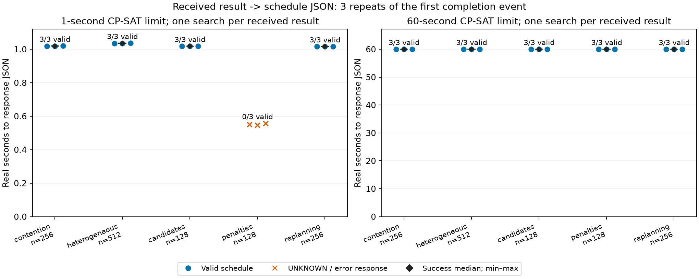

# 実験結果受領→スケジュールJSON生成

実測ソース: `047e4a7406939f6ac3c8fbc3d52bc308f131b92f`。保存計画の参照: `bf457334a0bddc3a75ff6560726a80e3c42dbf80`。
開始: `2026-10-30T00:18:52.968523+00:00`。CPU: Intel(R) Core(TM) Ultra 7 265KF、CP-SAT worker 1 / seed 0。
依存版とインストール全一覧は環境ファイルへ記録しました。

受信済みDataFrameをアプリへ渡してから、開始済み仕事の固定、履歴更新・完了処理、必要な状態遷移・タスク生成、CP-SAT再計画、全スケジュールJSON生成までを計時しました。
起動・入力準備・機器通信・描画・ファイル保存は含みません。デバッグ出力はメモリ上に捕捉します。既存更新APIを一度呼び、結果受領前の再計画を挟まず、探索は各応答1回です。

今回の入力は、前回の有効計画における最初の結果イベントです。すべて群途中のため、状態遷移・次群生成の分岐は今回の実測では実行されていません。その分岐は別の小規模回帰テストで確認しました。複雑な実験解析処理も模擬していません。



| 負荷 | 規模 | 探索秒 | 成功/試行 | 成功応答 中央値 / p95 / 最大（秒） | うち探索 中央値（秒） | その他 中央値（秒） | 失敗応答 中央値（秒） |
| --- | ---: | ---: | ---: | --- | ---: | ---: | ---: |
| contention | 256 | 1 | 3/3 | 1.018846 / 1.019672 / 1.019764 | 1.002012 | 0.016766 | — |
| contention | 256 | 60 | 3/3 | 60.016104 / 60.018556 / 60.018829 | 59.997252 | 0.017199 | — |
| heterogeneous | 512 | 1 | 3/3 | 1.035398 / 1.036172 / 1.036258 | 1.004203 | 0.031195 | — |
| heterogeneous | 512 | 60 | 3/3 | 60.024661 / 60.024981 / 60.025017 | 59.994064 | 0.030596 | — |
| many_candidates | 128 | 1 | 3/3 | 1.017589 / 1.018073 / 1.018126 | 1.001450 | 0.016452 | — |
| many_candidates | 128 | 60 | 3/3 | 60.019455 / 60.019705 / 60.019733 | 60.002346 | 0.016900 | — |
| mixed_penalties | 128 | 1 | 0/3 | — / — / — | — | — | 0.549869 |
| mixed_penalties | 128 | 60 | 3/3 | 60.015646 / 60.016121 / 60.016174 | 60.002921 | 0.012726 | — |
| replanning | 256 | 1 | 3/3 | 1.015690 / 1.015995 / 1.016028 | 1.001279 | 0.014467 | — |
| replanning | 256 | 60 | 3/3 | 60.014038 / 60.015849 / 60.016050 | 59.999685 | 0.014412 | — |

同じ受信済み結果・同じ計画を1/60秒に渡した各3反復の記述統計です。p95は少数点の線形補間で、将来の保証ではありません。中央値の内訳を別々に集計するため、内訳中央値の和は総時間中央値と厳密には一致しない場合があります。
UNKNOWNの時間はスケジュール生成成功の時間へ混ぜていません。

旧運用の約2/120秒は受領前の探索も含みます。本測定は受領後の1回の探索を計時しています。この初回成功は継続更新の成功を保証しません。

trial_metrics.csvは全試行、statistics.jsonは条件別の中央値・四分位範囲・p95・最小最大・平均・標本標準偏差です。raw_results.tar.gzに入力・出力・探索・失敗・ログを保持しています。入力ハッシュ・出力ハッシュ・環境・検証も併記しています。

```bash
MPLCONFIGDIR=/tmp/gems-latency-mpl MPLBACKEND=Agg poetry run python \
  scripts/measure_result_update_latency.py \
  --output /tmp/gems-result-latency-new --repetitions 3

# 保存された結果を再集計・図示するだけの場合
poetry run python -m scripts.report_result_update_latency /tmp/gems-result-latency-new
poetry run python -m scripts.verify_result_update_latency /tmp/gems-result-latency-new
```

新規測定には約15分の探索を要します。出力先は新しいディレクトリを指定します。

復元とハッシュ検査:

```bash
sha256sum -c raw_results.tar.gz.sha256
mkdir -p /tmp/gems-result-latency-restored
tar -xzf raw_results.tar.gz -C /tmp/gems-result-latency-restored
cd /tmp/gems-result-latency-restored/gems-result-latency-20261030
sha256sum -c SHA256SUMS
```

実装PRの差分へ図・生データを入れず、保存ブランチ `archive/23-result-update-latency` に保持しています。資料参照のためマージ後も保存ブランチを保持します。
