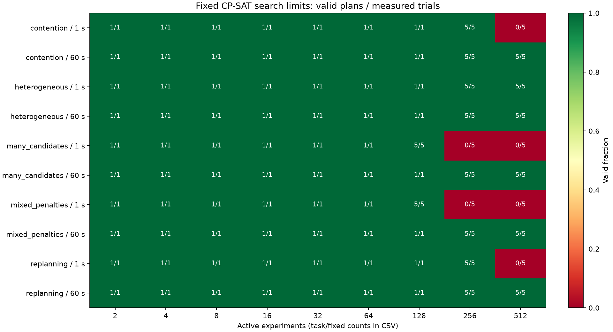

# Issue #23: fixed-search-limit capacity evaluation

The user changed the original Issue's time criterion: **1 / 60 seconds is the
fixed CP-SAT search limit**, applied directly to `max_time_in_seconds`. Model
construction, application, checks and update overhead do not consume that limit
or determine success. Early optimality ends a search without waiting.
The native solver limit is not an exact stopwatch cutoff; returning and stopping
can make measured search elapsed time slightly exceed its setting.
Each search in an update has its own limit; an update can contain multiple searches.

Success means `OPTIMAL` or `FEASIBLE` with a valid physical schedule. `UNKNOWN`
means no solution was found by that run, not proven infeasibility. The study
does not impose delay or quality thresholds and does not establish a total
one-second / sixty-second response guarantee.

## Configuration and reproduction

The primary run measured commit `9e269d41bd7ce83b80a99955856d14d46a018e3e`:
193 trials in 10,088.052 seconds, with no skipped condition. See the
[result overview](measurement_summary.md), [detailed statistics](summary.md),
[input/output verification](artifact_verification.json) and
[verification report](verification.md).

The [additional statistical analysis](statistics/README.md) retains medians,
quartiles, p95, sample deviations, paired-input quality comparisons and four
figures. It is generated from the saved CSV files without running a solver.
Primary repetitions and final-source confirmation remain separate.



The final source adds checks for inconsistent progress, restores pending
fixed-time work with unset IDs, treats zero-duration work as empty intervals and
fixes CLI state pickle identity. All retained inputs pass the final guards.
The largest five representative CP models and their solver settings are
identical: [model equivalence](model_equivalence.json). Primary timing and memory
figures belong to the measured commit; final-source confirmation is separate
and is not pooled with the primary repetitions.

The [final-source confirmation](confirmation_summary.md) retains
[17 conditions](confirmation.json) and its
[environment](confirmation_environment.json). Ten representative static inputs
were valid. The two 128-experiment / 1-second operational UNKNOWNs recurred;
both corresponding 64-experiment supplemental operations completed eight
updates. Each confirmation condition has one run, so those smaller successes
are observations, not reliable operational maxima.

```bash
MPLCONFIGDIR=/tmp/gems-mpl MPLBACKEND=Agg poetry run python \
  scripts/measure_scheduler_capacity.py \
  --config scripts/scheduler_capacity_config.json \
  --output /tmp/gems-capacity-study

# Rebuild tables from saved records, without solving again:
poetry run python scripts/measure_scheduler_capacity.py \
  --summarize /tmp/gems-capacity-study
poetry run python scripts/report_scheduler_capacity.py /tmp/gems-capacity-study
poetry run python scripts/verify_scheduler_capacity.py /tmp/gems-capacity-study

# Replay a saved trial (preserve the original directory first):
poetry run python scripts/measure_scheduler_capacity.py \
  --worker /tmp/gems-capacity-study/trials/<trial>/request.json
```

The main study refuses to reuse an existing output directory. A worker replay
writes `result.json`, `output.json` and any error in its request's directory.
Use a copy to preserve the original measured output.

The compressed `raw_artifacts.tar.gz` preserves the full study, requests,
outputs, failed inputs, exceptions, worker logs, IO files, verification logs and
final-source confirmation. Restore and check it from this directory:

```bash
sha256sum -c raw_artifacts.tar.gz.sha256
mkdir -p /tmp/gems-capacity-restored
tar -xzf raw_artifacts.tar.gz -C /tmp/gems-capacity-restored
cd /tmp/gems-capacity-restored/gems-issue23-capacity-20261029
sha256sum -c SHA256SUMS
```

From the repository root, export models without executing a search:

```bash
mkdir -p /tmp/gems-capacity-measured-source
git archive 9e269d41bd7ce83b80a99955856d14d46a018e3e |
  tar -x -C /tmp/gems-capacity-measured-source
poetry run python scripts/capture_scheduler_capacity_models.py \
  /tmp/gems-capacity-measured-source /tmp/gems-capacity-study /tmp/models-measured
poetry run python scripts/capture_scheduler_capacity_models.py \
  "$PWD" /tmp/gems-capacity-study /tmp/models-final
cmp /tmp/models-measured/model_fingerprints.json /tmp/models-final/model_fingerprints.json
```

Final-source confirmation uses each pattern's largest all-success 1-second static
condition, 512 experiments at 60 seconds, and its original 1-second operation
input. If the original or confirmation operation is UNKNOWN, separately labelled
smaller operations halve the size until an eight-update success or size 2.
These supplemental conditions have one run each and are not reliable maxima:

```bash
poetry run python scripts/confirm_scheduler_capacity.py \
  /tmp/gems-capacity-study /tmp/gems-capacity-final-confirmation
```

The confirmation controller enforces the combined six-hour allowance from the
primary environment's start timestamp. For a later replay of individual cases,
use copied worker requests instead of extending that expired allowance.

The tracked configuration fixes worker 1, seed 0, three tasks per group
(durations 5/3/4 minutes, preceding intervals 2/2/1 minutes), three group cycles,
eight operational updates and one new experiment at updates 2 and 4.
No experimental noise, sample splitting, real equipment or calibrated scientific
response model is used. CPU/OS interference can still vary search outcomes. No CPU affinity or exclusive
host isolation was used; brief QA commands also ran on this host.

| Pattern | Machines / timing |
| --- | --- |
| contention | Two machines of one type; preferred starts 10–13 minutes. |
| heterogeneous | Three successive types with 2/2/1 machines. |
| many_candidates | Eight same-type machines, increasing assignment choices. |
| mixed_penalties | Two machines; Linear, Range and Rest+Linear rotated by experiment index; rest cycle 120 minutes, inclusive ranges 20–30 and 90–105. |
| replanning | Two machines; every fourth group has completed first work and fixed remaining work. One task is already running at the reference time; future fixed tasks wait after a deterministic long interval. |

Sizes are 2/4/8/16/32/64/128/256/512 experiments. Each limit's scan stops after
the next size above its first failure; this is not an assumption of monotonicity.
The first-failure neighborhood, or the last two sizes if all passed, is repeated
to five runs per condition. Operational trials use the smaller of the two
limits' largest all-success measured sizes. The controller's total execution
allowance is six hours, independently of individual search limits. The worker
timeout is a separate emergency safeguard and is reported as `WORKER_TIMEOUT`.

## Records and interpretation

Each trial retains the exact typed input snapshot and SHA-256, result snapshot,
structured per-search records, exceptions and fresh-worker peak resident memory.
Only the output path is normalized for input hashing. Paired static conditions
have the same input hash; closed-loop inputs can diverge because schedules change
completion order. Updates retain their own inputs and every scheduling call,
including experiment additions. Static success does not guarantee that eight
closed-loop updates at the same size will succeed.

CSV/JSON summarize median, linearly interpolated p95 and maximum search/total
times, successes, statuses and memory. Raw records also retain weighted solver
objective and bound in identical units, penalty, delay distribution, pending
schedule utilization, group/task/machine/type/assignment/fixed/history counts.
Five repetitions do not constitute a precise operational p95 guarantee.
Memory includes imports; operational memory is the cumulative worker peak
across the whole attempted trial, including a failing update, not a per-update sample.
The recorded assignment-candidate count is the number compatible by type
before filtering fixed work to a known machine ID. `timing_penalty` covers all
active groups; the solver penalty and `movable_penalty` cover movable groups.
Objective and bound use the same weighted units and should not be summed across
calls with different weights or inputs. Search includes native presolve.
`total_seconds` times the trial operations (plus IO in an IO trial);
`worker_process_seconds` also includes startup, restoration and artifact output.
Saving/drawing is disabled in operational timing. Artifact serialization occurs
outside per-search timing. Separate two-experiment `io` trials record snapshot
saving and Gantt drawing times as reference costs.

Delay and schedule span use virtual minutes. Computation uses real seconds.
Low delay or high utilization does not demonstrate scientific validity or a
facility's sustainable throughput. Success at 512 means the tested upper limit
was reached, not that the maximum supported scale is 512.

## Verification

```bash
poetry run python -m unittest tests.test_scheduler_capacity \
  tests.test_capacity_measurement tests.test_cp_sat_scheduler \
  tests.test_experiment_simulators tests.test_persistence_roundtrip \
  tests.test_dataframe_backends tests.test_scheduler_pattern_study -q
```

The regressions cover the original f/s overlap, small counts and zero-duration
tasks, fixed future reservations, simultaneous events, missing machines, rejected
annealing fallback, all three limit interfaces and old saved data, UNKNOWN
classification, finite updates, absence of internal f calls in the o path, and
paired workload fingerprints. Results and observed failures are recorded in the
verification report accompanying the measured artifacts.
