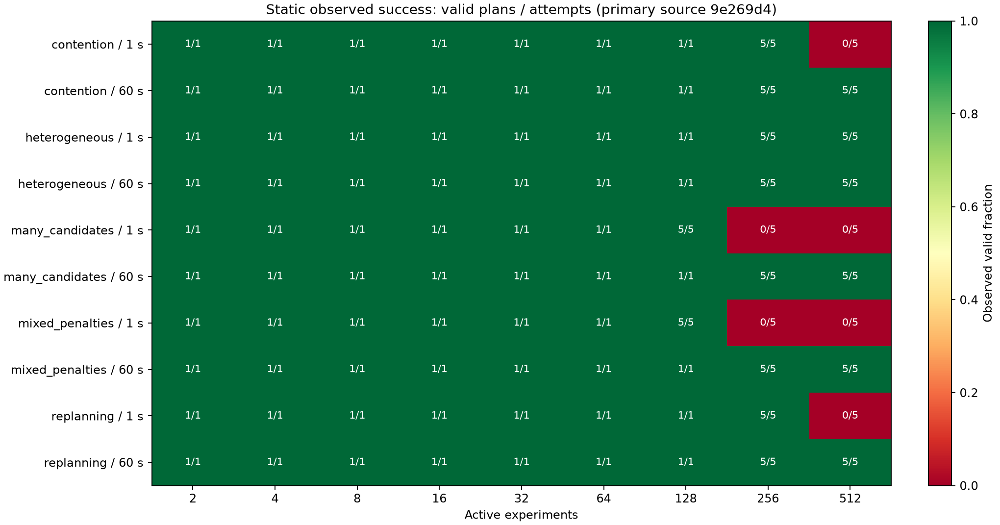
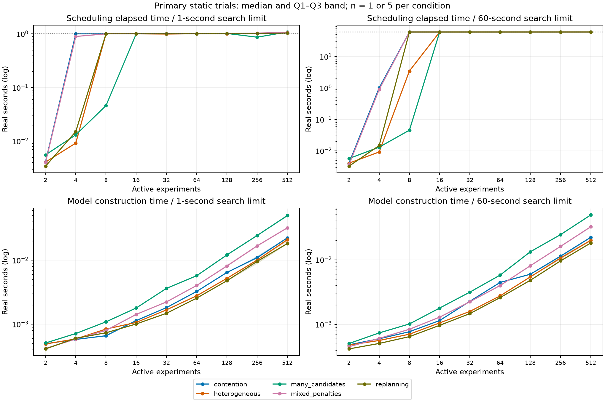
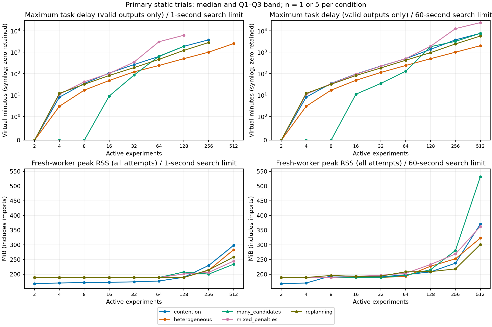
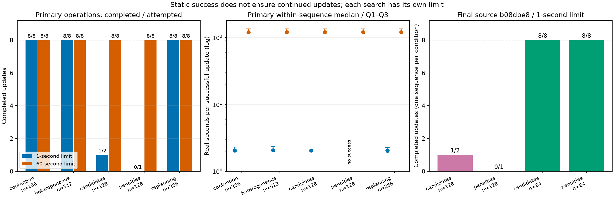

# Issue #23: 記述統計と図

主評価 `9e269d41bd7ce83b80a99955856d14d46a018e3e` の193試行を再集計した資料です。最終確認 `b08dbe83d1addf14dc40a845d1e5c52c9d58d48e` の17条件は独立に表示し、反復へ合算していません。
再探索なし。入力ファイルのSHA-256、全条件の統計は[statistics.json](statistics.json)、表は[condition_statistics.csv](condition_statistics.csv)へ保存しています。

## 集計方法と分母

- 主評価: 静的178試行（148成功・30失敗）、IO 5試行（5成功）、運用10系列（8成功・2失敗）。今回の失敗はすべてUNKNOWN。静的条件の反復数は1または5。
- 時間・メモリは失敗を含む全試行、遅延・ペナルティ・利用率は有効出力のみを集計。
- 中央値、Q1、Q3、線形補間p95、最大、平均、標本標準偏差を記録。n=1の標準偏差は未定義。図の帯はQ1–Q3で、信頼区間ではありません。少数反復のp95は将来の保証ではありません。
- 同一の決定的入力・seedでの反復です。施設・実験集団からの独立標本ではなく、成功率の一般化や統計的有意差の主張を行いません。
- 探索上限は各CP-SAT呼出しに1/60秒を直接設定。構築・反映・検査は合否対象外。UNKNOWNは実行不能の証明ではありません。

## 静的成功率

セルは有効計画数／試行数。灰色は未測定です。規模と失敗の単調性は仮定しません。



### 全反復成功の最大実測規模における統計

| 負荷 | 探索秒 | 規模 | 成功/反復 | 計画時間 中央値 / p95 / 最大（秒） | 構築時間 中央値（秒） | ピークRSS 中央値 / 最大（MiB） | 最大遅延 中央値（分） |
| --- | ---: | ---: | ---: | --- | ---: | --- | ---: |
| contention | 1 | 256 | 5/5 | 1.024 / 1.025 / 1.026 | 0.011 | 229.918 / 230.031 | 3815.000 |
| contention | 60 | 512 | 5/5 | 60.048 / 60.049 / 60.049 | 0.022 | 370.637 / 370.793 | 7654.000 |
| heterogeneous | 1 | 512 | 5/5 | 1.044 / 1.046 / 1.047 | 0.021 | 283.375 / 283.816 | 2544.000 |
| heterogeneous | 60 | 512 | 5/5 | 60.047 / 60.049 / 60.049 | 0.020 | 323.113 / 324.504 | 2032.000 |
| many_candidates | 1 | 128 | 5/5 | 1.020 / 1.021 / 1.021 | 0.012 | 207.648 / 207.812 | 1887.000 |
| many_candidates | 60 | 512 | 5/5 | 60.082 / 60.083 / 60.083 | 0.049 | 531.789 / 532.344 | 7647.000 |
| mixed_penalties | 1 | 128 | 5/5 | 1.019 / 1.020 / 1.020 | 0.008 | 200.887 / 201.152 | 6228.000 |
| mixed_penalties | 60 | 512 | 5/5 | 60.062 / 60.065 / 60.065 | 0.032 | 362.531 / 362.777 | 24347.000 |
| replanning | 1 | 256 | 5/5 | 1.022 / 1.022 / 1.022 | 0.010 | 214.695 / 214.961 | 2862.000 |
| replanning | 60 | 512 | 5/5 | 60.043 / 60.044 / 60.044 | 0.018 | 301.512 / 302.074 | 5743.000 |

512は測定上限です。成功した最大実測規模同士では負荷量が異なるため、この表の1秒と60秒の遅延・メモリを公平な品質比較として解釈しません。

## 計算時間・品質・メモリ

時間図は失敗も含みます。点は中央値、帯はQ1–Q3、横軸は実験数です。計画時間図の点線は探索設定値であり、計画全体の制限ではありません。



最大遅延は各計画内の最大値を条件ごとに集計し、有効出力のない条件は欠測です。仮想分と計算の実秒は異なる単位です。遅延0を残すためsymlog軸を使います。RSSは起動・importを含むワーカープロセス全体のピークです。



### 同一入力における品質比較

- 移動可能群のペナルティ: 両探索上限で有効解のある39条件中、60秒の中央値が小さい23、同じ16、大きい0条件。
- 最大遅延: 両探索上限で有効解のある39条件中、60秒の中央値が小さい20、同じ17、大きい2条件。

各条件の入力ハッシュ一致を確認し、異なる反復数を持つ条件もそれぞれの中央値を比較しました。試行の一対一対応や統計的検定は行いません。[paired_quality.csv](paired_quality.csv)には失敗側も欠測として残しています。最適化目的はペナルティを優先する重み付き目的値で、最大遅延そのものではありません。異なる入力・重みの目的値やペナルティはプールしません。

## 継続更新

各負荷・探索上限で運用系列は1回のみ。系列内の更新は独立な反復ではありません。1更新に通常2回の探索があり、実験追加も別の呼出しを行います。「成功／試行」は未実施更新を成功にも失敗にも数えていません。



| 負荷 | 規模 | 探索秒 | 成功/試行更新 | 成功更新時間 中央値 / Q1–Q3 / p95 / 最大（秒） | 系列全体（秒） |
| --- | ---: | ---: | ---: | --- | ---: |
| contention | 256 | 1 | 8/8 | 2.037 / 2.034–2.293 / 3.053 / 3.054 | 18.559 |
| contention | 256 | 60 | 8/8 | 120.031 / 120.029–135.037 / 180.042 / 180.043 | 1080.510 |
| heterogeneous | 512 | 1 | 8/8 | 2.071 / 2.070–2.337 / 3.122 / 3.124 | 19.125 |
| heterogeneous | 512 | 60 | 8/8 | 120.045 / 119.999–135.046 / 180.069 / 180.118 | 1080.691 |
| many_candidates | 128 | 1 | 1/2 | 2.039 / 2.039–2.039 / 2.039 / 2.039 | 3.799 |
| many_candidates | 128 | 60 | 8/8 | 120.039 / 120.038–135.047 / 180.059 / 180.060 | 1080.476 |
| mixed_penalties | 128 | 1 | 0/1 | — / —–— / — / — | 1.617 |
| mixed_penalties | 128 | 60 | 8/8 | 120.030 / 120.029–135.036 / 180.039 / 180.039 | 1080.384 |
| replanning | 256 | 1 | 8/8 | 2.032 / 2.030–2.286 / 3.046 / 3.047 | 18.570 |
| replanning | 256 | 60 | 8/8 | 120.030 / 120.027–135.034 / 180.044 / 180.047 | 1080.546 |

60秒の運用規模は上表の256/512/128/128/256で、全負荷512ではありません。最終ソースの1秒・128実験では割当候補多数と複雑ペナルティのUNKNOWNを再現し、別の補助64実験で両負荷8更新成功（各1系列）でした。信頼できる運用上限は未確定です。

## 再現

保存用コミットのリポジトリルートで実行します。スケジューラーは呼び出しません。

```bash
MPLCONFIGDIR=/tmp/gems-mpl MPLBACKEND=Agg poetry run python \
  scripts/analyze_scheduler_capacity.py \
  docs/benchmarks/scheduler_capacity \
  --output /tmp/gems-capacity-statistics
```

PNGとSVGを併記しています。主評価の入力・出力・失敗・全ログは[元資料](../README.md)の圧縮アーカイブとSHA-256で履歴に保持しています。
