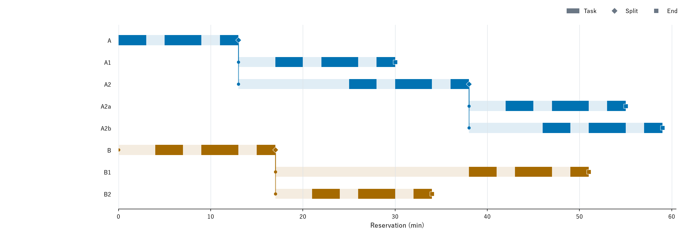
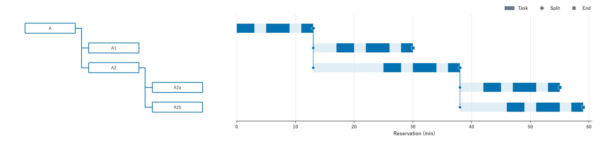
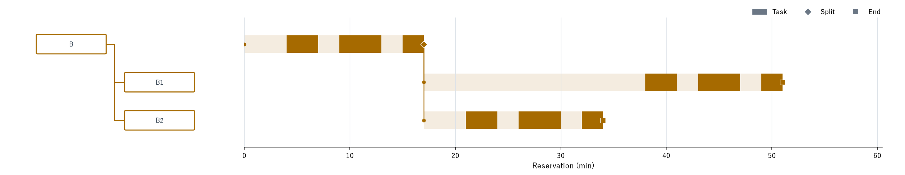
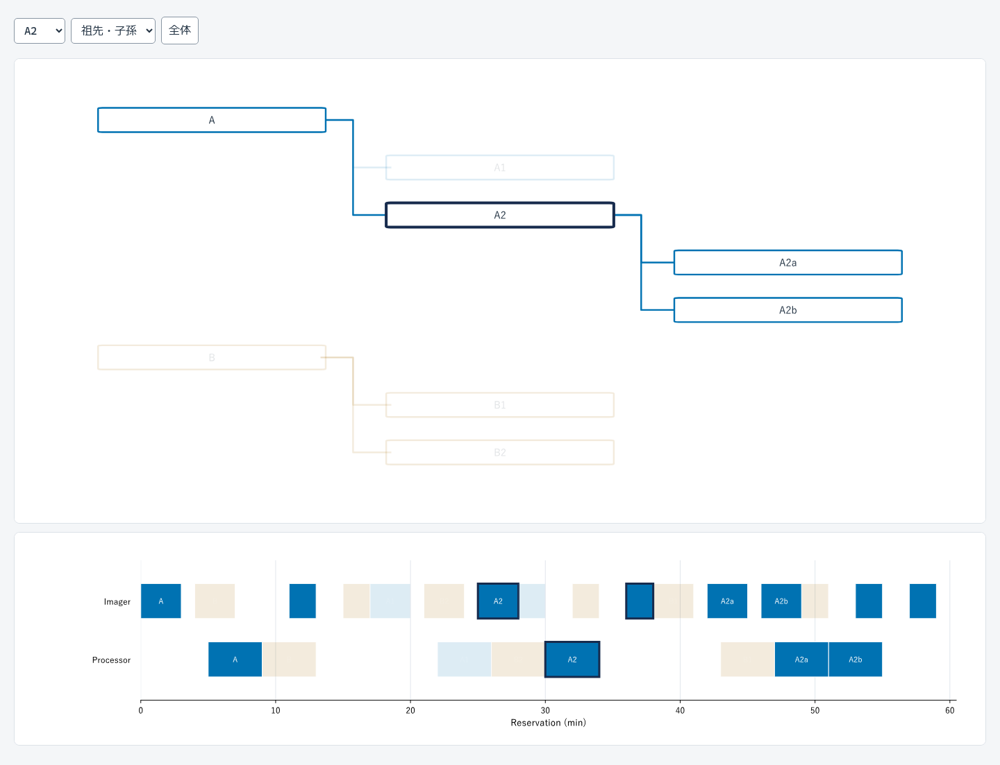

# 全Experiment終了後の可視化

終了・分割で Experiment と TaskGroup が活動一覧から消えた後も、親子関係と作業の予約時間を振り返れる。通常の可視化機能として①・③・④を実装した。

掲載図は、[仮想プロトコル](../../../tests/simulators/retrospective_review.py)を既存の CP-SAT スケジューラーで最後まで実行し、[最終保存](example/experiments.json)を再読込して生成した。2親・2世代、8 Experiment、24作業、3分割、全件終了まで59分。実機の記録や容量評価ではない。

## ① 全体

薄い帯は登録から終了まで、濃い棒は完了した作業の最終予約区間。◆は分割、■は終了。分割点から子へ線がつながる。作業間の空白の理由は推定しない。



## ③ 家系別

親子関係と時間図の行が対応する。全体図と時間範囲・家系の色を揃える。





## ④ 選択連動

[review.html](figures/review.html)を保存し、ブラウザで開く。**このHTMLだけで動作する。** GitHubのファイル表示はソース表示になるため、ダウンロードしたファイルを開く。

実験名の選択欄、親子図の箱、装置図の棒から選ぶ。両図で同じ対象を強調する。「祖先・子孫」「家系」「選択のみ」を切り替えられる。「全体」で解除する。図形にフォーカスして Enter / Space でも選べる。作業の詳細はマウスを重ねて確認する。キーボードと読み上げでも作業の情報を確認できる。



## 使用方法

```python
# 全Experimentが終了した管理オブジェクトから出力する。
lab.render_retrospective("review", font="/path/to/JapaneseFont.ttf", time_unit="min")
```

保存済みの実行も、実験を再実行せずに描ける。

```bash
MPLBACKEND=Agg python -m scripts.render_experiment_retrospective \
  --snapshot /path/to/snapshot --output /path/to/new-review \
  --font /path/to/JapaneseFont.ttf --time-unit min
```

`--snapshot`は`save_snapshot`の保存ディレクトリ、または`step_00000000`などの保存ステップ。JSONだけを読む場合は`--source json`を指定する。`--output`は新しいディレクトリとし、既存の出力は上書きしない。フォント指定は省略可能だが、日本語の実験名には対応するフォントが必要。時間単位はプロトコルの論理時間の単位を指定する。既定は`min`で、単位変換は行わない。

出力は全体図、家系別図の PNG/SVG、単独の `review.html`、`review-data.json`、ハッシュ付き `manifest.json`。実験数・名前・UUID・世代・装置は固定されていない。同名の実験には表示上の連番を付ける。全体図・家系別図は24件ごとに分け、ページをまたぐ祖先は文脈として再表示する。全ページで時間範囲を揃え、保存データの作業を二重登録しない。HTMLでは全件を表示する。

## 保存する情報と制限

`Experiments.retrospective_trace`に登録時の表示名・親UUID・論理時刻、および完了した作業の永続TaskGroup UUID・Task ID・Experiment UUID・操作・装置・最終予約開始/終了・結果受領時の管理論理時刻を残す。子の登録記録は分割確定と一緒に反映する。親の継承履歴を子の作業として再描画しない。結果の再送と分割の再確認で記録を増殖させない。

時間図の棒は**完了時点の予約**であり、実機の実測開始・終了ではない。結果受領時刻も実測終了の代わりにしない。計画変更の全履歴、待機理由、実機の実績は今回の図の対象外。

旧スナップショットには作業台帳や親の登録時刻がない。読込みは維持し、欠落した区間・時刻は推測せず、警告と `complete: false` を出す。登録記録のない名前は確定済み子仕様、またはUUIDを用いる。旧データを後から完全な時間図に変換する機能はない。

記録は作業数に応じて増える。この可視化追加後の容量測定は未実施で、既存の容量評価は固定した旧コミットの結果として維持する。

## 再生成と検証

```bash
# 仮想実験の実行 → JSON/pickle保存 → 再読込 → 描画
MPLBACKEND=Agg python -m scripts.run_experiment_retrospective_example \
  --output /path/to/new-run --font /path/to/JapaneseFont.ttf

# 掲載した保存データから描画だけを再生成
MPLBACKEND=Agg python -m scripts.render_experiment_retrospective \
  --snapshot docs/design/experiment_retrospective/example --source json \
  --output /path/to/new-review --font /path/to/JapaneseFont.ttf

python -m unittest tests.test_retrospective tests.test_lifecycle_persistence tests.test_experiment_lifecycle

# 任意の検証用環境に playwright と Chromium を入れて実行する。
python -m scripts.verify_experiment_retrospective_browser \
  --html /path/to/new-review/review.html --data /path/to/new-review/review-data.json \
  --report /path/to/browser-report.json --screenshot /path/to/review.png
```

ブラウザ検証は HTML だけを別ディレクトリへコピーして開き、全実験と3範囲の選択、全箱・全作業のクリックと Enter / Space、解除、390px幅を確認する。図の強調対象を独立した検査と照合し、コンソールエラー・外部通信・SVG IDの重複も検査する。[検証記録](verification.json)に実行環境と結果を保存する。掲載の日本語フォントは Yu Gothic（フォント本体は同梱しない）。SVGは文字をパス化している。

旧HTMLでは外部の `prototype.js` を置かずにHTML単独で開くと、選択が反応しないことを実ブラウザで再現した。JavaScript・SVG・データを内包する形式へ修正した。ブラウザ検証でSVGの文字や目盛線が図形のクリックを遮るケースも検出し、文字のポインター設定と作業の描画順序を修正した。
