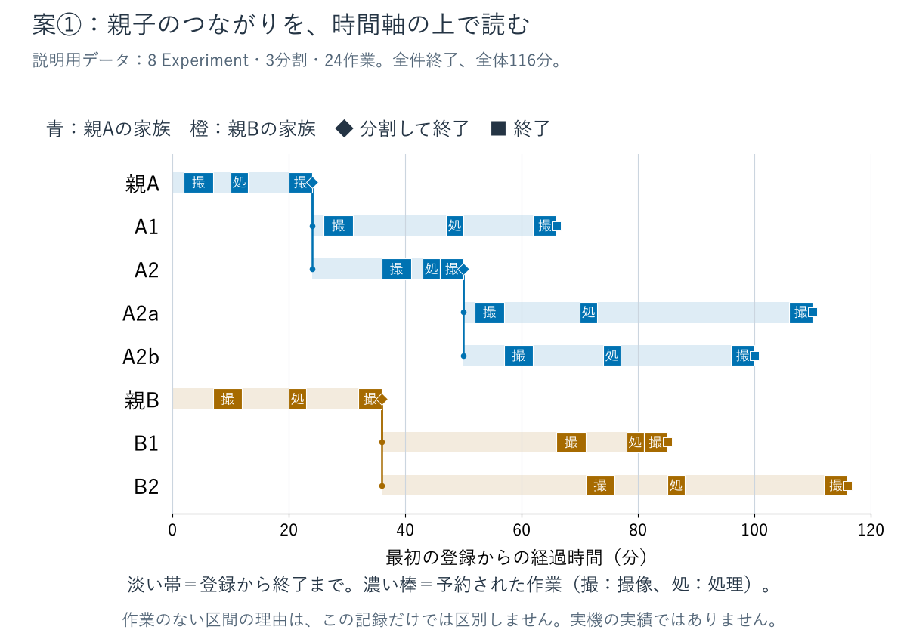
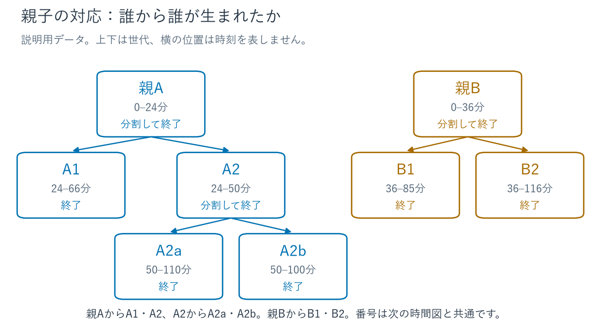
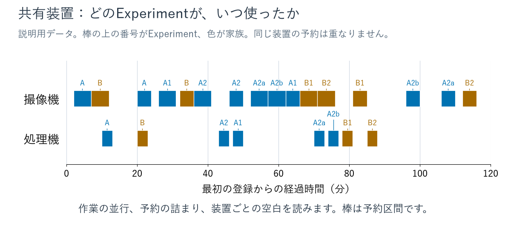
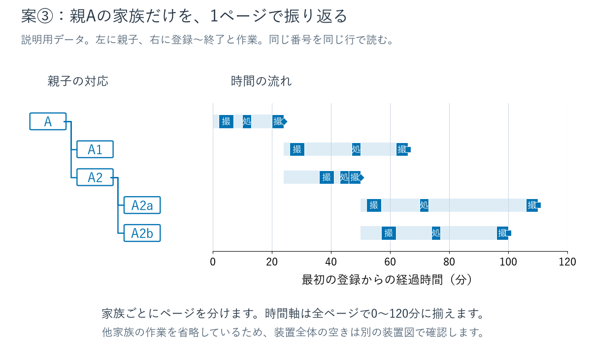
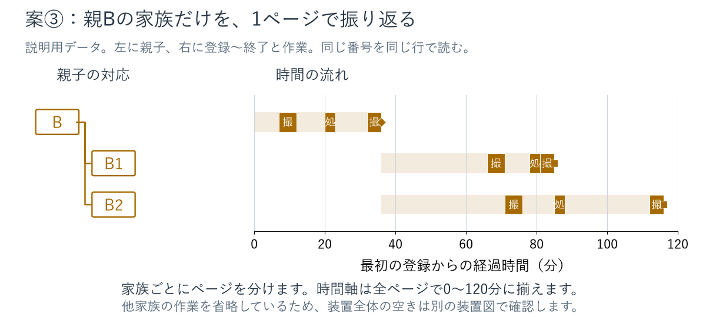
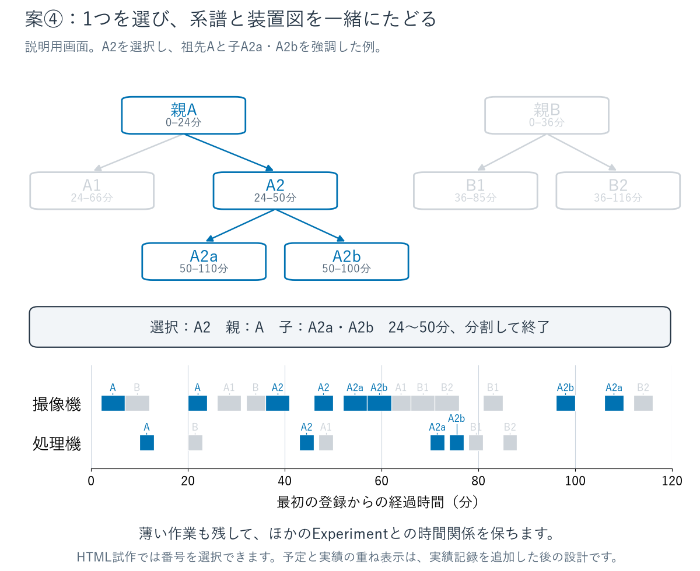

# 全Experiment終了後の振り返り：4つの可視化案

全件終了した後に、**どの親から生まれ、いつ作業し、どの装置を共有したか**を振り返るための設計案。
まず全体を把握し、気になった家族や作業へ進めることを重視する。
今回は比較用の図と画面試作を示す。実行管理への機能追加は行っていない。

全案で同じ[説明用データ](sample.json)を使う。
親A・親Bから始まり、A2はさらにA2a・A2bへ分割する。
8 Experiment・3分割・24作業、最初の登録から全件終了まで116分という**作図用の設定**で、
測定値・実機の実行記録ではない。
作業は共有の撮像機・処理機に予約されている。番号、家族の色、0〜120分の時間範囲を揃えた。

| 案 | まず答える問い | 向いている読み方 | 注意点 |
| --- | --- | --- | --- |
| ① 系譜つき時間図 | どこで分割し、いつ子が進んだか | 全体を一枚で振り返る | 件数が増えると縦に長くなる。装置全体の占有は別図が必要 |
| ② 系譜図＋装置別時間図 | 親子関係と、装置の使われ方はどうだったか | 2枚を同じ番号で照合する | 図を行き来して対応を読む |
| ③ 家族ごとのページ | この親から生まれた実験はどう進んだか | 家族単位で順に読む・共有する | 他家族との装置共有は全体の装置図で確認する |
| ④ 選択連動ビュー | 気になった子の祖先・子孫は、いつ装置を使ったか | 画面で選びながらたどる | ブラウザと操作が必要。紙面には選択した状態を出力する |

## ① 系譜つき時間図：一枚で全体をたどる

**縦にExperiment、横に時間**を置き、分割点から子の行へ線を伸ばす。
淡い帯は登録から終了までの期間、濃い棒は作業の予約区間。
◆は分割による終了、■は子を作らない終了。
「撮」「処」は撮像機・処理機の作業を表す。



親Aは24分、A2は50分で分割し、A2aとA2bはそれぞれ110分・100分に終了する。
どの子が同時期に存在していたか、世代をまたいでどれだけ時間がかかったかを追いやすい。
作業がない区間には培養・所定の間隔・装置待ちなどがあり得るため、
記録された理由なしにすべてを「装置待ち」とは呼ばない。

入口の全体図に向く。大きな実行では家族で区切るか、同じ横軸のままページを続ける。
この図の子の行に、継承した親の作業を再表示しない。
親の過去作業は親の行に残し、親子の線で履歴の由来を読む。

## ② 系譜図＋装置別時間図：関係と共有を分けて読む

先に系譜図で番号を確認し、次に装置別の図で同じ番号を探す。
系譜図の上下は世代で、横方向の位置は時刻を表さない。



装置別の図は**縦に装置、横に時間**。棒の上の番号が、その作業を行うExperiment。



例えば52〜62分にはA2a・A2bの撮像が続き、70分台には処理と撮像が並行する。
装置ごとの予約の詰まり・空白や、別家族の作業が入る位置を見やすい。
系譜と装置の図を隣り合わせ、または前後のページに置く。
作業数が多い場合は両図に共通の短い表示番号を使い、UUIDは詳細表で参照する。

## ③ 家族ごとのページ：親単位で落ち着いて読む

最初の親ごとにページを分ける。**左に親子、右に時間**を置き、
同じExperimentを同じ行に揃える。家族内の分割を詳しく追うための表示。





家族の件数が増えても、読み手が見る範囲を絞りやすい。印刷や家族単位の共有にも向く。
ページごとに時間軸を縮めず、全体の時間軸を維持することで終了時刻を比較できる。
他家族の作業は省略しているため、装置全体の空きや混雑は②の装置図と併せて確認する。
世代数・子数が多い家族は、親→子、子→孫と続きのページを作り、親の参照番号を引き継ぐ。

## ④ 選択連動ビュー：気になったExperimentからたどる

系譜と装置の図を同時に表示する。
番号を選ぶと、選んだExperimentと祖先・子孫を両図で強調する。
他の作業は薄く残し、全体の時間関係を保つ。



[選択できるHTML試作](figures/prototype.html)をローカルのブラウザで開く。
GitHub上ではHTMLがソース表示になるため、利用する場合はこのディレクトリを取得して
`prototype.html`を開く。隣の`prototype.js`も必要。外部サービスへ接続しない。
ボタン、図の番号・作業、キーボードで選択できる。
「祖先と子孫」「同じ家族すべて」「本人だけ」を切り替える。
この見本ではA1はA2の兄弟なので薄いが、「同じ家族すべて」ならA1も強調する。

大量の実験の中から、気になった子を起点に詳しく見る用途に向く。
レポートに残すときは、選択番号と強調範囲を添えて静止図を出力する。
予定と実績を比較する機能は試作していない。
実績が記録される場合には、同じ時間軸に予定を輪郭、実績を塗りで重ねる案がある。

## 組み合わせの提案

今回の要望では、**①を入口に、③を家族別の詳細として続ける構成**を第一候補にする。
親子と時間を同じ行で読めるため、最初から別の図で番号を探す負担が小さい。
装置の混雑を振り返りたい場合に②の装置図を添える。
画面で多数の実験を探索する用途が中心なら、④が候補になる。
これは読み方に基づく設計判断であり、利用者による比較評価はまだ行っていない。

## 現在の保存記録で描ける範囲

[終了・分割記録](../../../gems_python/multi_machine_problem_interval_task/lifecycle.py)には、
親UUID、子UUID群、分割の論理時刻、終了時刻・理由、継承した履歴がある。
全Experimentが自己消去した後も、系譜と終了イベントは追える。
一方、終了記録にExperimentの表示名を保持する共通項目はなく、
最初の親の登録時刻も専用項目としては保持していない。
子の登録は確定済み分割時刻に対応づけられるが、
最初の観測時刻を親の登録時刻として無条件に代用しない。
[結果処理](../../../gems_python/multi_machine_problem_interval_task/transition_manager.py)では
完了したTask群を活動一覧から外す。最終保存だけで全Taskの最終予約時刻・装置割り当てを
復元することは保証されない。実機の開始・終了の実績も、共通記録にはない。

実装する場合には、完了したTaskの記録を残す必要がある。
既存の結果ファイル・ステップ保存に必要な情報が残る場合は再利用し、
共通に保証する記録を定義する。主な項目は次のとおり。

| 記録 | 可視化に使う項目 |
| --- | --- |
| Experiment | UUID、表示番号・名前、親UUID、登録時刻、終了時刻・理由 |
| 分割イベント | 要求ID、親UUID、子UUID群、確定時刻 |
| 完了Task | Task群UUID・Task ID、Experiment UUID、操作名、装置ID、最終予約の開始・終了 |
| 実績（提供される場合） | 装置が報告した開始・終了、完了応答時刻。予約から推測して埋めない |
| 保留・待ち（理由を表示する場合） | 開始・解除時刻と理由。作業間の空白だけから推測しない |

現在の論理時刻は、装置実績の時刻と同一とは限らない。
完了応答の受領時刻と実際の終了時刻も区別する。
予約だけを使うレポートには「予約に基づく振り返り」と表示し、
実績のない作業に実行済みの区間を捏造しない。
子の継承履歴を親の作業としてもう一度数えることも避ける。

## 作図と確認

[描画器](../../../scripts/render_experiment_retrospective_proposals.py)は、
説明用JSONの親子関係、分割時刻と子の登録時刻、全件終了、作業の期間内配置、
同一装置・同一Experimentでの作業区間の非重複を検査する。
予定・実績の区別は入力と各図に明記した。
6枚のPNGと拡大用SVG、HTML/JavaScript試作を
[`figures/`](figures/)に同梱する。
使用フォントは環境のYu Gothicで、本体は配布しない。
入力、描画器、共通描画部品、字体、出力のハッシュを
[manifest](figures/manifest.json)に記録する。

全6 PNGを目視し、別出力先へ再生成したPNG/SVG各6枚・HTML・JavaScript・manifestの
15ファイルがバイト一致した。
ローカルMarkdownの画像参照6件・文書内のファイル参照、HTML内のSVG IDの一意性と参照、
32個のキーボード対象を確認した。
Node.jsでJavaScriptの構文、親子の選択関係11ケース、模擬DOMで初期表示・全体選択・
図の選択・家族範囲・本人範囲・キーボード選択の6シナリオを検査した。
模擬DOMの最初の検査では、検査側の`document`変数がNodeのstdin評価で未初期化の参照を
作ったため、`mockDocument`へ改名し、試作を変更せずに再確認した。
SVGを埋め込んだHTMLに末尾空白が残ったため、生成時に除去し、
差分検査と再生成の一致を再確認した。

再生成はプロジェクトの既存環境を使い、新しい出力先を指定する。

```bash
MPLBACKEND=Agg MPLCONFIGDIR=/tmp/gems-retrospective-mpl \
python -m scripts.render_experiment_retrospective_proposals \
  --data docs/design/experiment_retrospective/sample.json \
  --font /path/to/installed/YuGothM.ttc \
  --output /tmp/gems-retrospective-proposals
node --check /tmp/gems-retrospective-proposals/prototype.js
```

実機による実行・完了後の復元や、利用者テストは今回の設計比較の対象外。
HTML試作のブラウザでの描画・クリック確認も未実施であり、
静止図とJavaScriptの検査を分けて扱う。
