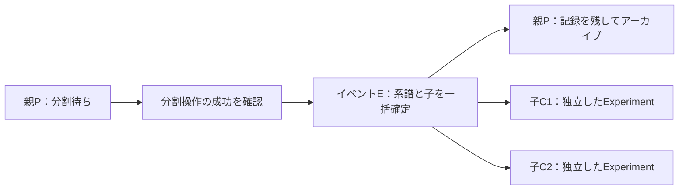
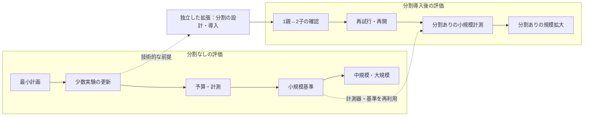

# 計算時間制約下の規模評価と、試料分割の試験機能案

2026-10-29 JST、Issue #21の追加検討。
基準コードはmain `aee423c0d7c78fd2a34062036669c1dad6164931`。
直前の[限界・残課題分析](limitations_and_unresolved_issues_2026-10-29.md)を具体化する。
**設計の検討であり、機能実装も大規模ベンチマークの実行もしていない。**

## ユーザー指定と今回の提案

ユーザー指定は次のとおり。

- 複雑な負荷について、スケジューリング時間を**1秒／1分**とした場合の処理可能規模を知りたい。
- 現段階では**確率的な実験摂動を入れないシミュレーション**でよい。摂動は後で追加する。
- 旧`s`・`f`の重複割当が「直っていない」とは何を意味するか確認したい。
- 試料分割は大きな拡張なので、**試験的な機能**として検討する。
- 今回は実装依頼ではない。先の分析も含め**PRは不要、履歴は保存**する。
- 追加指定として、**依存関係を踏まえ、小規模な順に進めたい**。
- 試料分割は大きな拡張なので、**分割なしでできる作業と、分割導入後の作業を分ける**。

以下の負荷数、判定指標、初期機能範囲は今回の提案である。
特に許容遅延・許容解品質・親を残すか・履歴の科学的な引継ぎ方法は、
実装前に用途から決める必要がある。今回は値を確定しない。

履歴は既存の専用ブランチ `docs/21-limitations-issue-review` とIssue #21に残す。
PR #22はユーザー指定により未マージで閉じ、先のコミット`f69706e`を保持する。
新規PR・mainへのマージは行わず、PDFはignore・未追跡のままとする。

## 1. 「1秒／1分でどこまで耐えるか」の評価案

### 1.1 計算時間を実測する決定的な仮想実験

最初の目的は、合成・決定的な仮想実験からスケジュールを作り、
**実際のコンピューター上で計算時間と出力を測ること**である。
実験操作の所要時間・観測値・実験追加の規則を固定するため、
実細胞の較正や確率的ノイズを先に導入する必要はない。
この結果は計算処理の性能であり、実験結果の科学的な妥当性の実証とは分ける。

まず既定のOR-Tools `o`を対象とする。旧方式の修正や焼きなましとの比較は
この規模評価の前提にしない。実験条件が決定的でも、壁時計の負荷と時間打切りによって
得られる解が完全に一致するとは限らないので、同じ入力の反復測定は必要となる。

### 1.2 時間の範囲を先に定義する

「1秒以内に耐える」は、ソルバーの探索時間だけでは判断しない。
初期案は**固定した計画入力が準備できてから、検証済み計画を返すまでの壁時計時間**
を主指標にし、1秒／60秒に対して判定すること。

| 計測 | 範囲と使い道 |
| --- | --- |
| 計画全体の時間 | 入力の整備、モデル構築、探索、割当の反映、独立した出力検証。1秒／60秒の主判定に使用する。 |
| モデル構築時間 | CP-SATモデルを作る時間。探索を短くしても減らない部分を切り分ける。 |
| ソルバー探索時間 | 探索の打切り時間と実時間、solver status、目的値と最良bound。 |
| シミュレーション更新全体 | 観測生成・履歴更新・状態遷移・そこで起きる全計画呼出し・出力検証。運用時の更新遅延を評価する。 |
| 保存・描画時間 | JSON/pickle、CSV、Gantt等を別に記録。初期の計画単体評価では含めず、保存ありの運用評価で確認する。 |

現行は`common/cp_sat_scheduler.py`で探索上限が5秒固定。
`max_time_in_seconds`を1や60にするだけでは、モデル構築・結果反映・検査まで含む
全体時間の上限にはならない。将来の評価では全体予算と探索予算を別に扱い、
予算超過を実測結果として記録する。厳密な打切りが必要な場合は別プロセス等で全体を
監視する設計が必要で、単に探索上限を指定して保証したことにはしない。

既存`compare_schedulers.run_manager`の`seconds`は公開`execute_scheduling`と
独立評価`evaluate`をまとめて計測している。内訳、反復統計、失敗の区別、規模探索を
加える土台になるが、現在のスクリプトはそのまま1秒／60秒の規模評価にはならない。

**時間単位も分ける。** 計算時間は実秒。実験の開始・処理時間・間隔は現行の整数分。
1秒の計算予算と、仮想実験の1分の操作時間を混同しない。

### 1.3 「規模」を実験数だけにしない

現行は各Experimentの現在のTaskGroupを計画する。全将来工程を展開したDAGを
一括最適化する方式ではない。同じ実験数でも、1群に含まれるタスク数、
機械の選択肢、実行中の固定タスク数、ペナルティによって計算量が変わる。

初期の規模指標は次の組とする。

`(活動中Experiment数, 未完了群数G, 未完了タスク数T, 機械タイプ数,
総機械数M, 割当候補の総数, 固定タスク数, 履歴行数)`

CP-SATはタスクごとに同タイプ機の割当候補を作る。
割当候補数はおおよそ `各タスクに適合する機械数の合計`。
機械を増やすと物理的な混雑は緩む一方、モデルの選択肢は増えるため、
機械数に対して計算時間が単調に改善するとは仮定しない。
多数の履歴行は計画単体と分け、状態判断・DataFrame更新・保存の負荷として測る。

### 1.4 初期の負荷パターン案

以下は確率を使わず、固定した規則で入力を作る提案。
数値は較正済みの実験値ではなく、境界を探すための候補である。

| パターン | 複雑さの作り方 | 確認したいこと |
| --- | --- | --- |
| A 同タイプの競合 | 同タイプ1〜数台、開始希望を集中／分散。群内は複数タスク。 | 同時要求が集中するときの限界と、群数・タスク数の影響。 |
| B 異種機械の工程 | 分注→培養→撮像のように3タイプを順番に使う。撮像機だけ少数にする等、ボトルネックを固定。 | タイプをまたぐ固定間隔と、一部設備への集中。 |
| C 同型機が多数 | 同タイプの機械数を増やし、同じ群数・タスク数で比較する。 | 割当候補の増加による計算負荷。 |
| D 時刻条件が複雑 | Linear/Range/Rest+Linear/Mixed、異なる希望時刻と周期。群開始が休止域の境界付近になる条件も用意。 | ペナルティの種類・周期が与える影響。 |
| E 途中の再計画 | 実行中のタスクを固定し、新しい実験を一定件数ずつ追加する。完了後に次の群へ移る。 | 初回計画と、固定仕事を抱えた更新計画の差。 |

Gの初期候補は`16, 32, 64, 128, 256, 512, 1024`。
1群のタスク数はまず3と8を別に扱い、成功境界近くを細かく調べる。
全条件の直積を最初から実行する計画にはしない。
小規模から順に増やし、失敗した規模の前後を測る。
境界より大きい条件も少数確認し、「ある規模の失敗＝それ以上はすべて失敗」とは
仮定しない。ケースは1秒と60秒で同じ入力ハッシュになるようにする。

休止周期は現行実装で周期長分の配列をモデル構築時に作る。
長い周期は探索だけでなく構築時間・メモリに影響し得るため、
周期長を固定した主評価と、周期長自体を変える評価を分ける。

### 1.5 通過判定と解の品質

単に「戻ってきた」だけでは通過としない。

1. 定めた計画全体予算内で結果を返した。
2. `OPTIMAL`または`FEASIBLE`であり、実機ID単位の重複が0。
3. 機械タイプ、群内の順序・間隔、基準時刻、既存の実行中時刻・割当を維持した。
4. 必要な用途では、許容する遅延・目的値の基準も満たした。

1〜3を満たす**制約を満たした計画の規模**と、4も満たす
**品質基準を満たす規模**は分けて報告する。
許容遅延・許容品質の数値は今回ユーザーから指定されていないので、未確定のままにする。
少数の機械に大量のタスクを並べれば、素早く有効な計画を作れても待ち時間は長くなる。
「計算が1秒で終わる」と「実験を時間内に捌ける」は別の結果になる。

比較では群開始の時刻ペナルティに加えて、希望開始からの遅れの中央値・p95・最大、
機械利用率、待ち時間を記録する。60秒の解を1秒の比較基準に使う場合も、
`OPTIMAL`でない限り「既知の比較解」とする。

現行のsolver目的は時刻ペナルティに、同点時の早期開始の項を加えている。
solver objectiveとbest boundからgapを算出するときは同じ目的の単位を使う。
時刻ペナルティそのものにsolverのbest boundを直接割り当てない。

失敗も分ける。

- 有効な入力で予算内に解が得られない／全体時間が超過した。
- `INFEASIBLE`が証明された、または不正入力・欠けた設備がある。
- 重複・割当・固定タスク維持などの出力検査に失敗した。
- メモリ・モデルサイズ・整数範囲の上限に達した。

時間内に解が見つからないことは、実行不能の証明とは呼ばない。
既存のログ／例外だけではこれらを十分に集計できないため、
将来の評価器では結果を構造化して保存する必要がある。

### 1.6 更新を繰り返す決定的シミュレーション

固定スナップショット評価の後、観測器を使う実行ループで継続運用を確認する。
例として、固定時間の操作を順番に行い、観測回数によって
「継続」「次工程」「終了」を決め、新規Experimentを既定の仮想時刻に投入する。
失敗・所要時間のノイズ・ランダムな到着はこの段階には入れない。

各更新で、活動中の群・タスク・履歴サイズ、全計画呼出しの時間、
更新全体の時間、観測・状態遷移・スケジュールを保存する。
計画予算は**個々のソルバー呼出し**だけでなく、必要に応じて
**1更新から次の計画を返すまで**にも適用して報告する。

現行`simulate_one`は最初と更新後に`execute_scheduling`を呼ぶ。
さらにmulti-machineの`TaskGroup.add_task_group`は内部で旧順次方式を呼ぶ。
したがって「ソルバー1回を1秒にした」と「1更新を1秒以内にした」は一致しない。
履歴更新・状態遷移後の中間計画と最終計画を含めて測る必要がある。

静的比較は同じ入力を1秒／60秒へ渡す。
閉ループでは計画結果が次の完了時刻や活動集合を変えるため、途中の入力まで
常に同じとは仮定せず、その差も記録する。
既存の仮想時刻を瞬時に進めるsimulationに計算時間を測って付記することと、
計算中に現実の操作時間が進む影響をモデル化することは別段階とする。

終了条件と同時刻イベントの処理順も固定する。
現行コードには最後の群を削除した後の「次タスクなし」の扱い等を確認する必要があるので、
大量実行を始める前に小規模の終了ケースを検証する計画とする。

### 1.7 集計と実行費用

同じケースを反復し、初回／通常時、中央値・p95・最大、予算内成功数、
最適証明数、メモリ最大値を出す。境界では反復を増やす。
少数反復のp95は精密な運用保証ではないので、測定数を併記する。
solver seed・worker数は初期には既存の0・1を固定し、実験摂動と区別する。

成果物は「最大何実験」という単一数値よりも、次の表を基本にする。

| パターン | G / T / M / 固定仕事 | 1秒の成功数・時間・品質 | 60秒の成功数・時間・品質 | 境界と失敗理由 |
| --- | --- | --- | --- | --- |
| 実測後に記入 | 実測後に記入 | 未測定 | 未測定 | 未測定 |

環境、CPU・メモリ、並行負荷、依存版、commit、入力ハッシュ、実行順、
探索／全体時間設定、失敗ログを記録する。
入力を再利用しても、方式間で変更済みオブジェクトを使い回さない。
生JSON/CSVを保持し、図と要約をそこから再計算できるようにする。

60秒の評価を全条件へ展開すると時間が増える。
まず少数条件で1秒側の境界を探し、その周辺を60秒で比較する段階案がよい。
将来の実行前に、呼出し数×予算と、1更新内の呼出し数から見積もりを提示する。
今回はこれらの計測を実行していないため、耐えられる数は未確定。

将来の摂動は、入力生成・観測器・イベント投入の層へ追加する。
基準の決定的トレースを保持し、所要時間・観測誤差・装置停止等を個別に加えることで、
計画器の規模限界と環境の不確実性を混ぜずに比較できる。

## 2. 旧`s`・`f`の重複割当は何が直っていないのか

**既定OR-Tools `o`では機械IDごとの非重複制約を導入済み。
以前の`s`・`f`の割当実装を修正したわけではない。**
最新mainを再取得したところ上記基準commitと同じで、以前の再現からコード変更はない。

同タイプの機械が2台あれば、同時に2タスクを行うこと自体は可能。
しかし、その2タスクを両方`m0`へ割り当てると、2台目が空いていても実行できない。
旧評価は「同タイプの同時タスク数が機械台数を超えないか」を中心に見ており、
「確定した同一ID上のタスクが重ならないか」とは別になっている。

[保存済みの実行結果](analysis/limitations_review_2026-10-29.json)の`f`例：

| 群・タスク | 割当機械 | 仮想実験での区間 |
| --- | --- | --- |
| 群2・タスク0 | `m0` | `[22, 27)`分 |
| 群3・タスク0 | `m0` | `[23, 28)`分 |

重複は`[23,27)`の4分。これは**計算に4分かかった**という意味ではない。
同じ固定入力で`o`は重複0、`f`と`s` seed 0/1/2は各4分だった。
今回は保存結果から区間を再計算し、旧方式を再実行したわけではない。

旧`TaskGroup.schedule_task_groups`の終了イベントは、
そのタスクに割り当てた機械IDではなく、同タイプの使用中機械を解放する。
使用中機械をまとめて空きと扱う場合があり、別の実行中タスクが占有するIDを再利用できる。
さらに`s`は順次方式の初期割当後に開始時刻を変更するが、
最終結果の実機ID割当を作り直して検証する段階がない。
単にSAが最適性を証明できないという問題とは異なる。

今回の検討方針は、通常利用・規模評価は`o`を対象にすること。
旧方式を引き続き比較・利用する場合には、別の修正範囲として
終了時に正しいIDを解放し、SA後に割当を作り直し、
全方式共通の出力検査でID重複を拒否することが必要となる。

なお、更新中の`TaskGroup.add_task_group`には旧順次方式の内部呼出しが残る。
最終計画に`o`を使っていても、実行中の割当が中間処理で変わらないかは別に確認すべき点。
「既定ならすべての経路で問題が消えた」とまでは、この固定例だけから保証しない。

## 3. 試料分割を試験機能として導入する案

### 3.1 最初の範囲

初期案は**multi-machineの仮想実験で、1親から複数の子を生成する機能**。
明示的に有効化した実験だけで使い、通常のExperiment/Stateの振舞いを維持する。
初期段階で汎用の合流・実験間同期・任意の試料トポロジーまで扱わない。
将来実機対応を行う場合は、物理分割の完了確認と再起動時の照合を追加する。
これらは提案であり、「試験機能」というユーザー方針以外の初期範囲は未確定。

**分割の計画を立てたことと、試料が実際に分割されたことを分ける。**
通常のタスク関数で分割操作を生成し、その成功を確認してから子を有効化する設計案。
既存の`transition_function -> str`を突然「文字列または複数Experiment」に変えず、
試験機能の管理層が分割要求と完了イベントを扱う。

### 3.2 最低限の記録

| 記録 | 必要な情報と意味 |
| --- | --- |
| 分割要求 | 安定したrequest ID、親UUID、実行対象の分割操作ID、子の仕様、履歴引継ぎ方針。再試行しても同じ要求を識別する。 |
| 分割イベント | 親子UUID、分割時刻、要求ID、完了確認、履歴の参照位置・ハッシュ、適用した変換、版。後から出自を追えるようにする。 |
| 子の仕様 | 新UUID・名前・物理試料/容器ID、初期State、State設定、開始観測、バックエンド。親の実行中Taskや機械割当はコピーしない。 |
| 親の扱い | 分割後に活動集合から外すか、親を残すか。削除ではなく完了・移管の記録を残す。 |

タスク群IDとタスクIDだけを永続的な分割要求IDに使わない。
現行では削除後に群IDが再利用され得るため、操作を一意に識別するIDが必要となる。
イベントと親子はUUID参照で関連付け、Pythonオブジェクトの親↔子参照による循環は作らない。

現在の保存codecはdataclass・設定・共有参照を扱えるが、
これだけで新しい系譜記録の互換性や中断耐性が確認されたことにはならない。
実装時には試験機能の版とクラスのモジュールを保存し、旧形式との対応を検証する。

### 3.3 親をどうするか

| 案 | 利点・注意点 |
| --- | --- |
| 親は活動終了、すべて子へ移す | 初期実装を絞れる。残りを使い続ける場合も「残余の子」として表現できる。親の記録はアーカイブへ残す。 |
| 親を残して一部を子へ移す | 部分採取を自然に表せるが、親の残量・状態・次の操作との整合性まで扱う必要がある。 |

**初期の提案は前者。** 親を消去するという意味ではない。
既存の`delete_experiment_with_experiment_uuid`は再計画・保存も伴うため、
これをそのまま系譜上のアーカイブとして使う設計にはしない。
子の作成前に親の観測と設定を記録し、活動集合と過去記録を分けて管理する。

物理量を扱う場合は、単位・配分・残余・損失を明示する。
例えば容積の配分と、細胞密度の引継ぎは同じ計算ではない。
普遍的な保存則や許容誤差を機能側で勝手に決めない。

### 3.4 履歴を丸ごとコピーしてよいか

そのままコピーすると、親の継代回数・最終密度・容器・時刻等が子の現在状態と
誤認される可能性がある。DataFrameを別オブジェクトにするだけでは科学的な問題は解決しない。

| 案 | 評価 |
| --- | --- |
| 親の全履歴を子の履歴にコピー | 既存Stateを再利用しやすいが、子の履歴として集計すると二重計上や誤った状態判断が起きやすい。既定案にはしない。 |
| 親の履歴を参照し、子は新しい履歴から開始 | 出自と子自身の観測を分けられる。子の初期観測を明示する必要がある。初期提案。 |
| 親の一部を選択・変換して子に引き継ぐ | 継代後の予測に必要な設定等を扱えるが、列ごとの意味と変換をプロトコルが定義する必要がある。 |

初期案では、親の分割時点までの履歴を読み取り専用の出自として保持し、
子の履歴は子自身の初期観測から始める。
初期観測が測定値か、親から導いた値か、継承した設定かを区別する。
子のStateと観測器は新しい仕様から生成し、親の全Experimentや進捗をdeepcopyしない。
同じ設定で作る場合でもStateの動的進捗をリセットする条件を明示する。
Pandas/Polarsは親の選択バックエンドを維持する案とし、各子の履歴は独立させる。

### 3.5 一括登録、再試行、再計画失敗

現行`add_experiment`は1件ごとに再計画・保存を実行する。
これを子の数だけ順番に呼ぶと、途中まで登録された系譜や、不要な複数回の再計画が起きる。
試験機能では別の一括処理として検討する。

1. 子の全仕様、UUID、初期State・観測、バックエンド、対象機械を検証する。
2. 分割完了前の要求なら親を待機させ、子はまだ活動させない。
3. 成功確認後、分割イベント・親の活動終了・子の登録を一つの変更として確定する。
4. 全子を含む活動集合で再計画する。
5. 要求IDと仕様ハッシュを保存し、同じ完了応答を再受信しても子を増やさない。

仕様の事前検証が失敗した場合は、物理操作を開始せず親と活動集合を維持する。
一方、**物理分割後の失敗は、親を元へ戻したことにしてはいけない。**
子の実在を記録し、登録・再計画が完了しない場合は保留・照合待ちにする。
再計画失敗を理由に試料の出自を消去しない。

「同じ要求は同じ子UUIDを返す」「同じIDで違う仕様なら衝突エラー」が基本案。
新IDを毎回作ってリトライすると二重登録を検出できない。
これは論理的な二重登録防止であり、外部装置の不可逆操作のexactly-once保証ではない。

### 3.6 保存・再開と段階的な導入

| 段階案 | 範囲・確認条件 |
| --- | --- |
| 第1段階：仮想実験の試験機能 | 明示的に有効化、1親→複数子、親のアーカイブ、出自、独立履歴、一括登録、重複応答の防止を検証。実機への自動分割は対象にしない。 |
| 第2段階：保存・再開 | 要求前／完了確認後／確定後／再計画失敗時で保存し、別プロセス再開と応答再送を確認。イベントと活動集合を同じ保存世代として確定する。 |
| 第3段階：実機接続 | 物理分割完了の確認、実在する子のID・量・容器の照合、応答喪失時の手動判断、再実行しない条件を整備する。 |

現行のJSON/pickleは順次書込みであり、イベントと活動集合をクラッシュ時にも
同一世代で保存する保証はない。第2段階でこの点を扱う必要がある。
保存形式に分割イベントを加えるだけで中断・再開を完成したとはしない。
試験機能ではこの段階と対応範囲を表示し、既定動作を変更しない。

### 3.7 仮想実験での確認例

- 1親から2子を作り、異なる初期状態・操作を開始できる。
- 子1の観測追加・状態変更で子2と親の出自記録が変化しない。
- 親のTask・ID・機械割当・動的State進捗を子が引き継がない。
- 無効な子仕様が1件でもあれば一部登録にならない。
- 同じ分割完了を2回受けても子数・系譜が増えない。
- 子の生成後に必要機械がなくても、分割の出自を失わず保留を表せる。
- 親・子・イベントをJSON/pickleで往復し、再開後もID・初期条件・系譜が一致する。
- 子がさらに分割されたときにUUIDで系譜を追える。合流は初期対象外。
- 10親×2子等の決定的分割イベントを規模評価へ投入し、子数増加と再計画時間を測る。

最後の例は将来の両検討の接続点である。
第1段階の規模評価自体は分割機能を待たず、通常の新規実験追加で開始できる。

## 4. 次の実装判断に必要な材料

検討段階では次を未確定事項として残す。今回は承認待ちで作業を止める必要はない。

| 判断事項 | 初期提案・理由 |
| --- | --- |
| 1秒／60秒の対象 | 計画全体を主指標、探索時間と更新全体を併記。利用者が待つ時間を評価するため。 |
| 「耐える」の品質条件 | 有効な計画の規模と、遅延・品質基準を満たす規模を別報告。許容値は用途から決める。 |
| 試験機能の最初の対象 | multi-machineの仮想実験。実機完了と復旧の仕様を後段へ分けるため。 |
| 分割後の親 | アーカイブして全量を子へ移す案。残余は子として表現し、親継続の複雑さを初期から含めない。 |
| 子の初期観測と設定 | 出自参照と子の観測を分離し、引継ぎ・変換を明示。値の意味はプロトコルが定義する。 |
| mainへの反映 | 今回は専用ブランチに履歴を保持する。PRなしでmainへ反映する方式は今回の依頼範囲に含めない。 |

### 4.1 分割なしでできる作業と、分割導入後の作業

ユーザー指定により、**試料分割を独立した大きな拡張として扱う**。
通常の計画・運用・規模評価の途中に、分割実装を必須工程として挟まない。
それぞれの区分の中で、実験規模と変更範囲を小さく始める。
表の件数は今回の提案であり、測定済みの限界値ではない。
ここに書いた作業も今回実装・実行するものではない。

#### A. 分割なしで進める作業

| 順序 | 小さく始める範囲 | 必要な依存 | 次へ進む確認条件 |
| --- | --- | --- | --- |
| A1 最小の計画を確認 | 1〜4群、1〜2台、既定`o`。既存の小規模ケースを再利用する。 | なし。現行コードと独立した出力検査を使う。 | ID重複0、正しいタイプ・間隔・基準時刻。固定した実行中のタスクを動かさない。 |
| A2 少数実験の更新を確認 | 1〜2実験、2状態、数ステップ。生成→開始→完了→次群→終了を扱う。 | A1。 | 更新後も計画が有効で、時刻・割当を維持する。旧`f`の内部呼出しが影響するなら、その経路だけを先に修正する。通常停止を確認する。 |
| A3 時間予算と計測を用意 | A1/A2のケースに1秒／60秒を適用する。 | A1/A2の正しさ。 | モデル構築・探索・出力検査・更新全体の区別、超過・解なし・不正結果の記録ができる。 |
| A4 小規模の基準を測る | 2→4→8→16実験等。少数の競合・異種機械パターンで測る。 | A3。 | 同一入力で1秒／60秒を比較し、時間・有効性・遅延・品質を記録できる。見つかった不具合はこの規模で再現して修正する。 |
| A5 中規模から大規模へ広げる | 32→64→128…へ段階的に増やす。固定入力と更新を繰り返す運用をそれぞれ測る。 | A4。分割機能への依存はない。 | 境界前後を反復測定し、入力・環境・失敗理由を保持する。計算時間の限界と設備処理量の限界を分ける。 |

**最初の対象はA1〜A5の決定的シミュレーション。**
これだけで、分割なしの通常運用について1秒／60秒でどこまで耐えるかを調べられる。
モデル構築・探索・履歴更新等の改善と、同じ入力での再測定もこの区分で行える。

将来、通常負荷へ確率的摂動を加える場合も、必要なのはこの区分の決定的な基準。
分割機能の完成待ちにはしない。ただし、現段階で摂動を入れない方針は維持する。

#### 試料分割の設計・導入は独立した拡張

分割の設計・実装自体は第3節の別テーマとする。
着手時期をAの評価工程へ自動的に組み込まない。
導入する際の技術的な前提はA2の更新の正しさと、
第3節にある親子・初期条件・履歴・一括登録・再試行の仕様。
分割の影響を比較するため、A4/A5の計測器と基準を再利用する。
A5の性能目標をすべて達成することが、分割実装の技術的な必須条件という意味ではない。

#### B. 分割機能の導入後に確認・評価する作業

| 順序 | 小さく始める範囲 | 必要な依存 | 次へ進む確認条件 |
| --- | --- | --- | --- |
| B1 分割結果の基本動作 | 仮想実験で1親→2子を1回。親のアーカイブ、出自、独立履歴、子の新規タスクを確認する。 | 分割機能の最小実装、A2。 | 子が独立に動き、親の進捗・Task・割当を複製しない。一部だけ登録される状態を作らない。 |
| B2 分割の再試行・再開 | 同じ1親→2子で応答再送、仕様不正、計画失敗、JSON/pickle再開を扱う。 | B1と対応する保存・再開実装。 | 同じ要求で子が増えず、親子・イベント・初期条件が再開後に一致する。書込み中断への保証は対応段階を分ける。 |
| B3 分割ありの小規模計測 | 2親→4子等。子の一括追加と再計画を測る。 | B2、A3/A4の計測器・基準。 | 分割前後の活動数、計画時間、更新時間、履歴・系譜のメモリを記録できる。 |
| B4 分割ありの規模拡大 | 親数・子数・分割頻度を一つずつ増やす。 | B3。 | 通常負荷の基準と比較し、単なるタスク数増加と分割処理自体の負荷を区別できる。 |

将来、分割ありの負荷に摂動を入れる場合はBの決定的な基準を先に残す。
実機接続・合流は、初期の仮想実験とは別の拡張として扱う。

AにはBを待つ依存を設けていない。
旧`s`・`f`の全面修正も必須依存にはせず、
A2で既定`o`の更新経路に影響する問題が確認された場合だけ、先にその部分を扱う。
既存の全テストの不整合も、関連する確認を妨げるものと独立の整備課題を分ける。
どちらの区分でも、失敗を規模だけの問題と決めつけず、
同じ入力での小規模再現を残してから次へ進む。

## 5. 今回行った確認

- 最新mainをfetchし、`aee423c0d7c78fd2a34062036669c1dad6164931`のままであることを確認。
- 共通CP-SAT、multi-machineのタスク・管理・simulation、比較スクリプト、
  DataFrameのコピーと保存codecを読み、設計案の前提と内部呼出しを照合。
- 保存済みの5方式/seed結果を読み、`f`の同一`m0`上の`[23,27)`重複を再計算。
  新しいsolver実行・全テスト・大規模負荷実行はしていない。
- 文書リンク、差分の空白、変更ファイル一覧、PDFのSHA-256・ignore・未追跡を確認。
- PR #22を未マージで閉じ、既存分析と今回の検討を同じ専用ブランチの履歴へ保存。

この文書の性能値の欄は未測定のままにしている。
試験機能・予算制御・評価器は未実装であり、ここに書いた仕様で動くという報告ではない。
